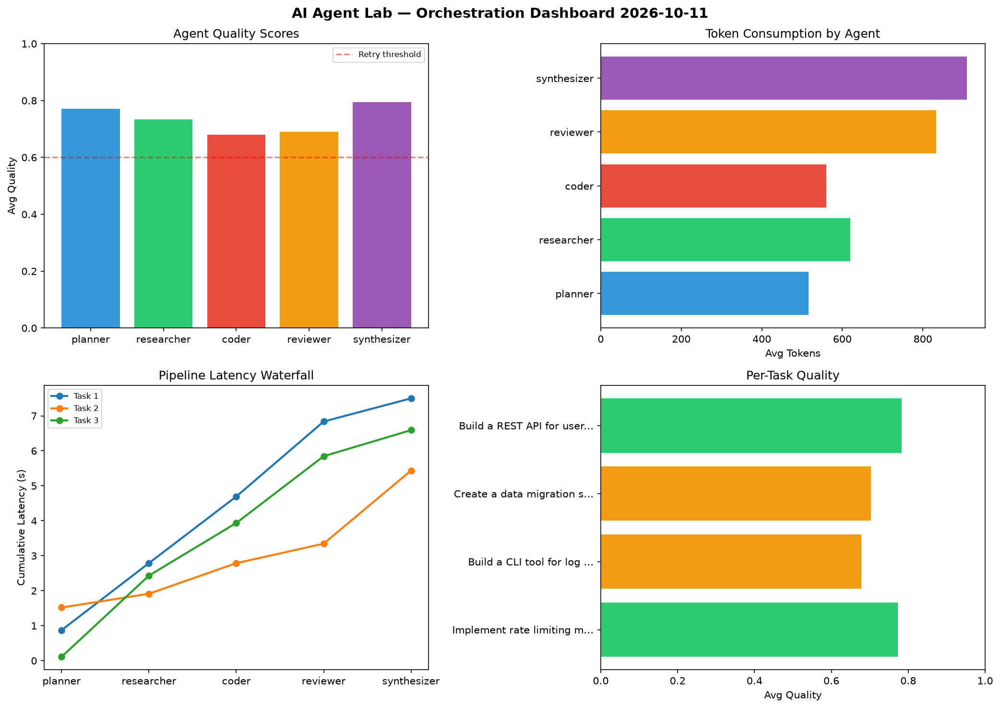

# AI Agent Lab — Orchestration Report 2026-10-11

**Run ID:** `fa22b56547` | **Tasks:** 4 | **Avg Quality:** 0.734

## Aggregate Metrics

| Metric | Value |
|--------|-------|
| avg_latency | 6.051 |
| total_tokens | 13756 |
| avg_quality | 0.734 |

## Delta vs Yesterday

| Metric | Today | Yesterday | Change |
|--------|-------|-----------|--------|
| avg_latency | 6.051 | 5.85 | 📈 3.4% |
| total_tokens | 13756 | 14734 | 📉 -6.6% |
| avg_quality | 0.734 | 0.717 | 📈 2.4% |

## Pipeline Results

### Implement rate limiting middleware
| Agent | Quality | Latency | Tokens | Status |
|-------|---------|---------|--------|--------|
| planner | 0.817 | 0.873s | 831 | success |
| researcher | 0.659 | 1.917s | 501 | success |
| coder | 0.843 | 1.904s | 884 | success |
| reviewer | 0.582 | 2.144s | 1201 | needs_retry |
| synthesizer | 0.966 | 0.662s | 591 | success |

### Build a CLI tool for log analysis
| Agent | Quality | Latency | Tokens | Status |
|-------|---------|---------|--------|--------|
| planner | 0.594 | 1.519s | 393 | needs_retry |
| researcher | 0.722 | 0.395s | 329 | success |
| coder | 0.579 | 0.874s | 585 | needs_retry |
| reviewer | 0.572 | 0.558s | 664 | needs_retry |
| synthesizer | 0.922 | 2.09s | 954 | success |

### Create a data migration script for schema v2
| Agent | Quality | Latency | Tokens | Status |
|-------|---------|---------|--------|--------|
| planner | 0.799 | 0.11s | 388 | success |
| researcher | 0.755 | 2.323s | 546 | success |
| coder | 0.565 | 1.504s | 366 | needs_retry |
| reviewer | 0.672 | 1.909s | 419 | success |
| synthesizer | 0.724 | 0.745s | 1174 | success |

### Build a REST API for user authentication
| Agent | Quality | Latency | Tokens | Status |
|-------|---------|---------|--------|--------|
| planner | 0.875 | 0.581s | 451 | success |
| researcher | 0.803 | 2.146s | 1104 | success |
| coder | 0.734 | 1.592s | 408 | success |
| reviewer | 0.935 | 0.21s | 1049 | success |
| synthesizer | 0.566 | 0.148s | 918 | needs_retry |
