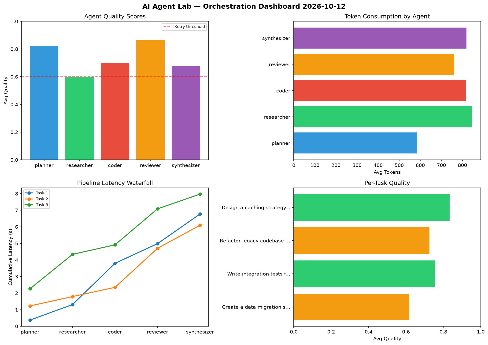

# AI Agent Lab — Orchestration Report 2026-10-12

**Run ID:** `8a001f96f8` | **Tasks:** 4 | **Avg Quality:** 0.733

## Aggregate Metrics

| Metric | Value |
|--------|-------|
| avg_latency | 7.082 |
| total_tokens | 15306 |
| avg_quality | 0.733 |

## Delta vs Yesterday

| Metric | Today | Yesterday | Change |
|--------|-------|-----------|--------|
| avg_latency | 7.082 | 7.193 | 📉 -1.5% |
| total_tokens | 15306 | 14543 | 📈 5.2% |
| avg_quality | 0.733 | 0.71 | 📈 3.2% |

## Pipeline Results

### Create a data migration script for schema v2
| Agent | Quality | Latency | Tokens | Status |
|-------|---------|---------|--------|--------|
| planner | 0.507 | 0.373s | 520 | needs_retry |
| researcher | 0.515 | 0.936s | 973 | needs_retry |
| coder | 0.64 | 2.489s | 563 | success |
| reviewer | 0.809 | 1.184s | 904 | success |
| synthesizer | 0.621 | 1.79s | 902 | success |

### Write integration tests for payment processing module
| Agent | Quality | Latency | Tokens | Status |
|-------|---------|---------|--------|--------|
| planner | 0.991 | 1.226s | 387 | success |
| researcher | 0.536 | 0.565s | 376 | needs_retry |
| coder | 0.88 | 0.557s | 737 | success |
| reviewer | 0.767 | 2.354s | 420 | success |
| synthesizer | 0.595 | 1.391s | 667 | needs_retry |

### Refactor legacy codebase to use dependency injection
| Agent | Quality | Latency | Tokens | Status |
|-------|---------|---------|--------|--------|
| planner | 0.802 | 2.261s | 517 | success |
| researcher | 0.687 | 2.077s | 927 | success |
| coder | 0.667 | 0.574s | 983 | success |
| reviewer | 0.955 | 2.171s | 757 | success |
| synthesizer | 0.518 | 0.888s | 1145 | needs_retry |

### Design a caching strategy for high-traffic endpoints
| Agent | Quality | Latency | Tokens | Status |
|-------|---------|---------|--------|--------|
| planner | 0.995 | 1.879s | 920 | success |
| researcher | 0.656 | 1.906s | 1102 | success |
| coder | 0.615 | 1.774s | 981 | success |
| reviewer | 0.931 | 1.033s | 962 | success |
| synthesizer | 0.97 | 0.9s | 563 | success |
