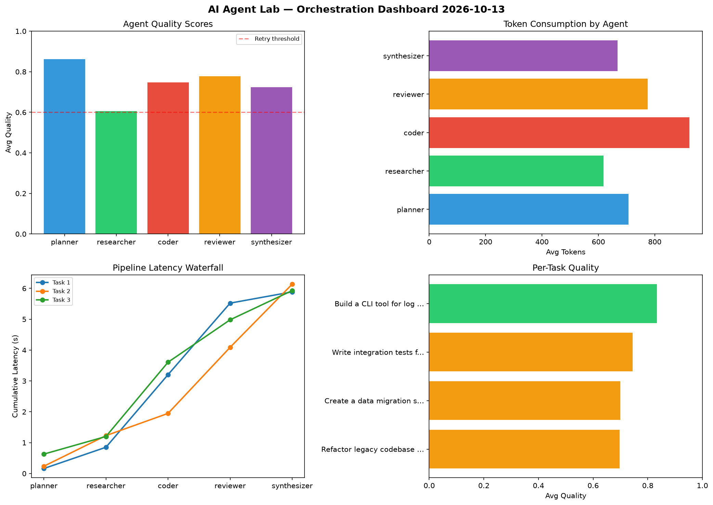

# AI Agent Lab — Orchestration Report 2026-10-13

**Run ID:** `8d015da04c` | **Tasks:** 4 | **Avg Quality:** 0.744

## Aggregate Metrics

| Metric | Value |
|--------|-------|
| avg_latency | 5.306 |
| total_tokens | 14766 |
| avg_quality | 0.744 |

## Delta vs Yesterday

| Metric | Today | Yesterday | Change |
|--------|-------|-----------|--------|
| avg_latency | 5.306 | 7.78 | 📉 -31.8% |
| total_tokens | 14766 | 12660 | 📈 16.6% |
| avg_quality | 0.744 | 0.763 | 📉 -2.5% |

## Pipeline Results

### Refactor legacy codebase to use dependency injection
| Agent | Quality | Latency | Tokens | Status |
|-------|---------|---------|--------|--------|
| planner | 0.873 | 0.162s | 410 | success |
| researcher | 0.504 | 0.689s | 658 | needs_retry |
| coder | 0.619 | 2.354s | 1000 | success |
| reviewer | 0.785 | 2.317s | 1012 | success |
| synthesizer | 0.702 | 0.365s | 313 | success |

### Create a data migration script for schema v2
| Agent | Quality | Latency | Tokens | Status |
|-------|---------|---------|--------|--------|
| planner | 0.681 | 0.236s | 658 | success |
| researcher | 0.599 | 0.992s | 1054 | needs_retry |
| coder | 0.749 | 0.72s | 609 | success |
| reviewer | 0.863 | 2.142s | 650 | success |
| synthesizer | 0.606 | 2.047s | 982 | success |

### Write integration tests for payment processing module
| Agent | Quality | Latency | Tokens | Status |
|-------|---------|---------|--------|--------|
| planner | 0.985 | 0.629s | 704 | success |
| researcher | 0.652 | 0.571s | 418 | success |
| coder | 0.95 | 2.407s | 806 | success |
| reviewer | 0.53 | 1.375s | 509 | needs_retry |
| synthesizer | 0.603 | 0.947s | 562 | success |

### Build a CLI tool for log analysis
| Agent | Quality | Latency | Tokens | Status |
|-------|---------|---------|--------|--------|
| planner | 0.91 | 0.815s | 1056 | success |
| researcher | 0.671 | 1.382s | 342 | success |
| coder | 0.67 | 0.455s | 1276 | success |
| reviewer | 0.933 | 0.157s | 930 | success |
| synthesizer | 0.985 | 0.462s | 817 | success |
