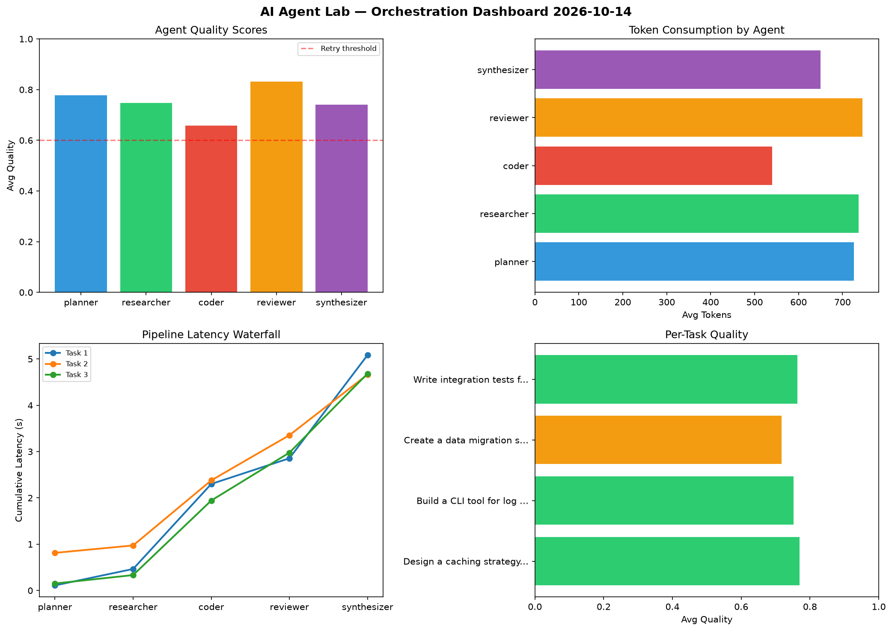

# AI Agent Lab — Orchestration Report 2026-10-14

**Run ID:** `7d1417484c` | **Tasks:** 4 | **Avg Quality:** 0.751

## Aggregate Metrics

| Metric | Value |
|--------|-------|
| avg_latency | 5.488 |
| total_tokens | 13595 |
| avg_quality | 0.751 |

## Delta vs Yesterday

| Metric | Today | Yesterday | Change |
|--------|-------|-----------|--------|
| avg_latency | 5.488 | 7.2 | 📉 -23.8% |
| total_tokens | 13595 | 16200 | 📉 -16.1% |
| avg_quality | 0.751 | 0.801 | 📉 -6.2% |

## Pipeline Results

### Design a caching strategy for high-traffic endpoints
| Agent | Quality | Latency | Tokens | Status |
|-------|---------|---------|--------|--------|
| planner | 0.931 | 0.11s | 804 | success |
| researcher | 0.754 | 0.355s | 831 | success |
| coder | 0.673 | 1.836s | 369 | success |
| reviewer | 0.905 | 0.554s | 521 | success |
| synthesizer | 0.588 | 2.23s | 467 | needs_retry |

### Build a CLI tool for log analysis
| Agent | Quality | Latency | Tokens | Status |
|-------|---------|---------|--------|--------|
| planner | 0.679 | 0.813s | 961 | success |
| researcher | 0.695 | 0.16s | 815 | success |
| coder | 0.667 | 1.405s | 685 | success |
| reviewer | 0.794 | 0.976s | 1094 | success |
| synthesizer | 0.925 | 1.31s | 666 | success |

### Create a data migration script for schema v2
| Agent | Quality | Latency | Tokens | Status |
|-------|---------|---------|--------|--------|
| planner | 0.778 | 0.151s | 719 | success |
| researcher | 0.602 | 0.182s | 570 | success |
| coder | 0.683 | 1.61s | 620 | success |
| reviewer | 0.849 | 1.034s | 704 | success |
| synthesizer | 0.675 | 1.707s | 693 | success |

### Write integration tests for payment processing module
| Agent | Quality | Latency | Tokens | Status |
|-------|---------|---------|--------|--------|
| planner | 0.72 | 0.395s | 422 | success |
| researcher | 0.937 | 2.409s | 731 | success |
| coder | 0.608 | 0.674s | 486 | success |
| reviewer | 0.78 | 2.445s | 662 | success |
| synthesizer | 0.773 | 1.596s | 775 | success |
