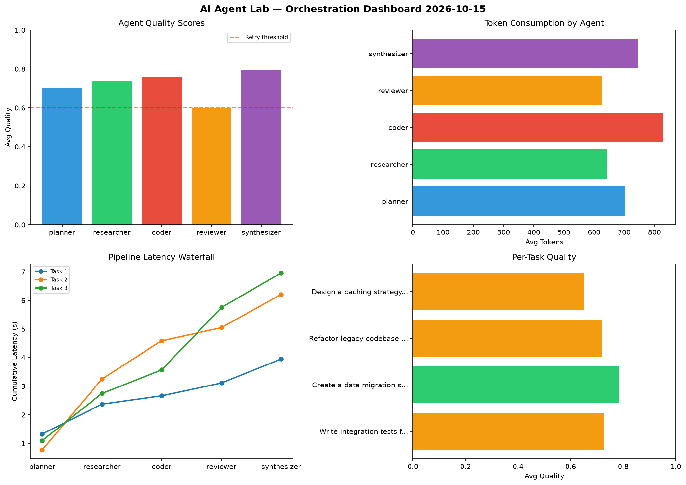

# AI Agent Lab — Orchestration Report 2026-10-15

**Run ID:** `01b965fd46` | **Tasks:** 4 | **Avg Quality:** 0.719

## Aggregate Metrics

| Metric | Value |
|--------|-------|
| avg_latency | 5.982 |
| total_tokens | 14181 |
| avg_quality | 0.719 |

## Delta vs Yesterday

| Metric | Today | Yesterday | Change |
|--------|-------|-----------|--------|
| avg_latency | 5.982 | 5.488 | 📈 9.0% |
| total_tokens | 14181 | 13595 | 📈 4.3% |
| avg_quality | 0.719 | 0.751 | 📉 -4.3% |

## Pipeline Results

### Write integration tests for payment processing module
| Agent | Quality | Latency | Tokens | Status |
|-------|---------|---------|--------|--------|
| planner | 0.835 | 1.33s | 1056 | success |
| researcher | 0.904 | 1.044s | 307 | success |
| coder | 0.66 | 0.292s | 695 | success |
| reviewer | 0.726 | 0.447s | 499 | success |
| synthesizer | 0.517 | 0.837s | 602 | needs_retry |

### Create a data migration script for schema v2
| Agent | Quality | Latency | Tokens | Status |
|-------|---------|---------|--------|--------|
| planner | 0.749 | 0.773s | 506 | success |
| researcher | 0.737 | 2.478s | 639 | success |
| coder | 0.848 | 1.34s | 1193 | success |
| reviewer | 0.632 | 0.46s | 588 | success |
| synthesizer | 0.945 | 1.158s | 873 | success |

### Refactor legacy codebase to use dependency injection
| Agent | Quality | Latency | Tokens | Status |
|-------|---------|---------|--------|--------|
| planner | 0.607 | 1.101s | 760 | success |
| researcher | 0.541 | 1.646s | 840 | needs_retry |
| coder | 0.916 | 0.824s | 968 | success |
| reviewer | 0.538 | 2.18s | 647 | needs_retry |
| synthesizer | 0.986 | 1.21s | 711 | success |

### Design a caching strategy for high-traffic endpoints
| Agent | Quality | Latency | Tokens | Status |
|-------|---------|---------|--------|--------|
| planner | 0.619 | 1.755s | 483 | success |
| researcher | 0.769 | 0.527s | 779 | success |
| coder | 0.61 | 1.537s | 461 | success |
| reviewer | 0.51 | 1.635s | 775 | needs_retry |
| synthesizer | 0.736 | 1.353s | 799 | success |
