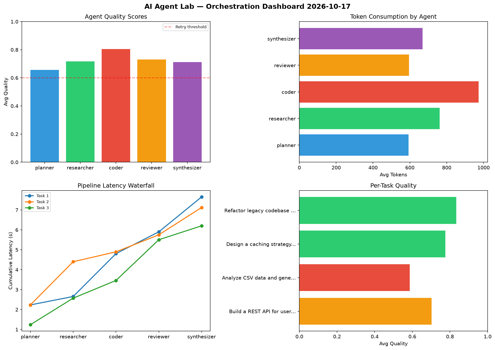

# AI Agent Lab — Orchestration Report 2026-10-17

**Run ID:** `987bb15b5a` | **Tasks:** 4 | **Avg Quality:** 0.724

## Aggregate Metrics

| Metric | Value |
|--------|-------|
| avg_latency | 7.144 |
| total_tokens | 14371 |
| avg_quality | 0.724 |

## Delta vs Yesterday

| Metric | Today | Yesterday | Change |
|--------|-------|-----------|--------|
| avg_latency | 7.144 | 6.548 | 📈 9.1% |
| total_tokens | 14371 | 14541 | 📉 -1.2% |
| avg_quality | 0.724 | 0.695 | 📈 4.2% |

## Pipeline Results

### Build a REST API for user authentication
| Agent | Quality | Latency | Tokens | Status |
|-------|---------|---------|--------|--------|
| planner | 0.513 | 2.233s | 782 | needs_retry |
| researcher | 0.678 | 0.424s | 791 | success |
| coder | 0.987 | 2.151s | 1124 | success |
| reviewer | 0.82 | 1.092s | 1022 | success |
| synthesizer | 0.51 | 1.753s | 604 | needs_retry |

### Analyze CSV data and generate statistical summary
| Agent | Quality | Latency | Tokens | Status |
|-------|---------|---------|--------|--------|
| planner | 0.555 | 2.233s | 344 | needs_retry |
| researcher | 0.624 | 2.168s | 696 | success |
| coder | 0.516 | 0.497s | 952 | needs_retry |
| reviewer | 0.589 | 0.853s | 535 | needs_retry |
| synthesizer | 0.645 | 1.372s | 393 | success |

### Design a caching strategy for high-traffic endpoints
| Agent | Quality | Latency | Tokens | Status |
|-------|---------|---------|--------|--------|
| planner | 0.604 | 1.24s | 922 | success |
| researcher | 0.654 | 1.333s | 944 | success |
| coder | 0.815 | 0.888s | 765 | success |
| reviewer | 0.89 | 2.044s | 342 | success |
| synthesizer | 0.91 | 0.697s | 776 | success |

### Refactor legacy codebase to use dependency injection
| Agent | Quality | Latency | Tokens | Status |
|-------|---------|---------|--------|--------|
| planner | 0.953 | 0.221s | 323 | success |
| researcher | 0.913 | 2.429s | 615 | success |
| coder | 0.901 | 1.306s | 1053 | success |
| reviewer | 0.62 | 2.137s | 483 | success |
| synthesizer | 0.783 | 1.503s | 905 | success |
