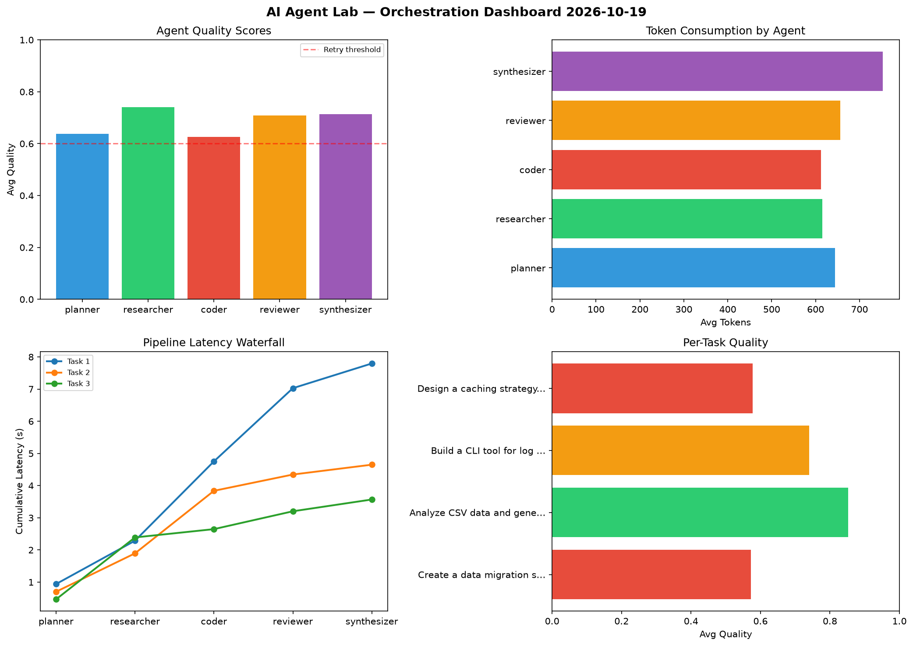

# AI Agent Lab — Orchestration Report 2026-10-19

**Run ID:** `8828e72ad7` | **Tasks:** 4 | **Avg Quality:** 0.685

## Aggregate Metrics

| Metric | Value |
|--------|-------|
| avg_latency | 5.944 |
| total_tokens | 13127 |
| avg_quality | 0.685 |

## Delta vs Yesterday

| Metric | Today | Yesterday | Change |
|--------|-------|-----------|--------|
| avg_latency | 5.944 | 6.184 | 📉 -3.9% |
| total_tokens | 13127 | 13953 | 📉 -5.9% |
| avg_quality | 0.685 | 0.811 | 📉 -15.5% |

## Pipeline Results

### Create a data migration script for schema v2
| Agent | Quality | Latency | Tokens | Status |
|-------|---------|---------|--------|--------|
| planner | 0.614 | 0.94s | 997 | success |
| researcher | 0.629 | 1.347s | 730 | success |
| coder | 0.556 | 2.466s | 625 | needs_retry |
| reviewer | 0.533 | 2.275s | 531 | needs_retry |
| synthesizer | 0.529 | 0.768s | 642 | needs_retry |

### Analyze CSV data and generate statistical summary
| Agent | Quality | Latency | Tokens | Status |
|-------|---------|---------|--------|--------|
| planner | 0.636 | 0.701s | 882 | success |
| researcher | 0.921 | 1.193s | 289 | success |
| coder | 0.883 | 1.944s | 503 | success |
| reviewer | 0.875 | 0.506s | 451 | success |
| synthesizer | 0.945 | 0.306s | 1093 | success |

### Build a CLI tool for log analysis
| Agent | Quality | Latency | Tokens | Status |
|-------|---------|---------|--------|--------|
| planner | 0.677 | 0.465s | 306 | success |
| researcher | 0.893 | 1.924s | 853 | success |
| coder | 0.509 | 0.258s | 534 | needs_retry |
| reviewer | 0.788 | 0.555s | 926 | success |
| synthesizer | 0.832 | 0.366s | 683 | success |

### Design a caching strategy for high-traffic endpoints
| Agent | Quality | Latency | Tokens | Status |
|-------|---------|---------|--------|--------|
| planner | 0.622 | 1.718s | 393 | success |
| researcher | 0.519 | 0.993s | 590 | needs_retry |
| coder | 0.559 | 1.68s | 787 | needs_retry |
| reviewer | 0.64 | 2.241s | 717 | success |
| synthesizer | 0.55 | 1.128s | 595 | needs_retry |
