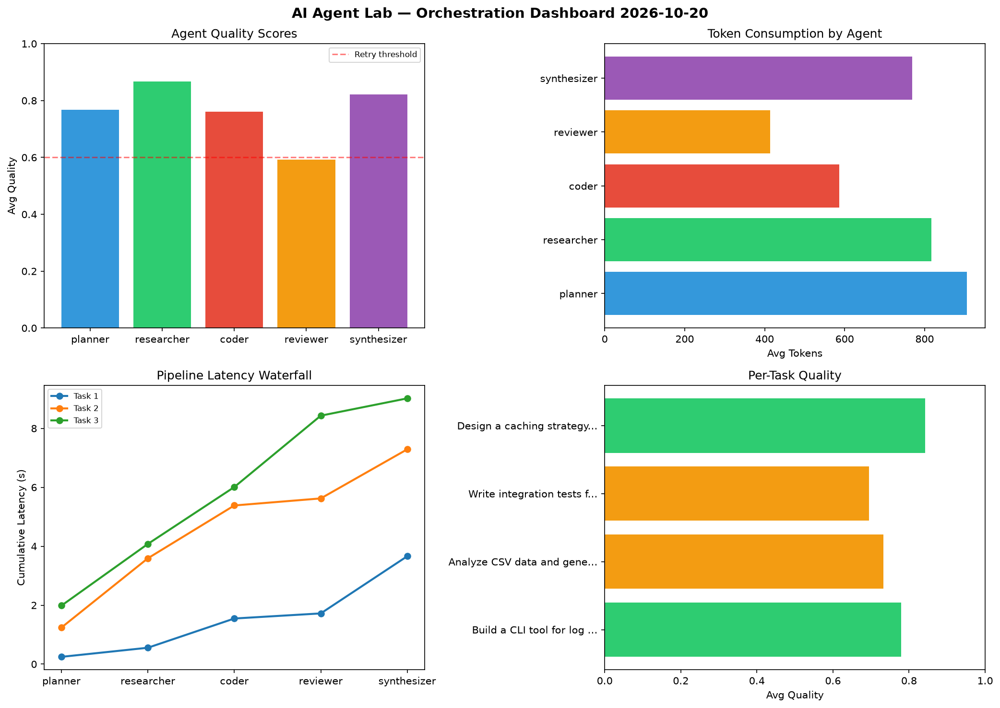

# AI Agent Lab — Orchestration Report 2026-10-20

**Run ID:** `ea926f3b24` | **Tasks:** 4 | **Avg Quality:** 0.762

## Aggregate Metrics

| Metric | Value |
|--------|-------|
| avg_latency | 6.216 |
| total_tokens | 13966 |
| avg_quality | 0.762 |

## Delta vs Yesterday

| Metric | Today | Yesterday | Change |
|--------|-------|-----------|--------|
| avg_latency | 6.216 | 6.543 | 📉 -5.0% |
| total_tokens | 13966 | 15772 | 📉 -11.5% |
| avg_quality | 0.762 | 0.746 | 📈 2.1% |

## Pipeline Results

### Build a CLI tool for log analysis
| Agent | Quality | Latency | Tokens | Status |
|-------|---------|---------|--------|--------|
| planner | 0.753 | 0.247s | 857 | success |
| researcher | 0.999 | 0.309s | 1144 | success |
| coder | 0.951 | 0.992s | 413 | success |
| reviewer | 0.564 | 0.173s | 252 | needs_retry |
| synthesizer | 0.626 | 1.94s | 639 | success |

### Analyze CSV data and generate statistical summary
| Agent | Quality | Latency | Tokens | Status |
|-------|---------|---------|--------|--------|
| planner | 0.765 | 1.24s | 832 | success |
| researcher | 0.919 | 2.351s | 917 | success |
| coder | 0.781 | 1.793s | 765 | success |
| reviewer | 0.501 | 0.239s | 531 | needs_retry |
| synthesizer | 0.693 | 1.666s | 727 | success |

### Write integration tests for payment processing module
| Agent | Quality | Latency | Tokens | Status |
|-------|---------|---------|--------|--------|
| planner | 0.581 | 1.984s | 711 | needs_retry |
| researcher | 0.792 | 2.094s | 674 | success |
| coder | 0.545 | 1.931s | 709 | needs_retry |
| reviewer | 0.56 | 2.422s | 565 | needs_retry |
| synthesizer | 0.995 | 0.587s | 751 | success |

### Design a caching strategy for high-traffic endpoints
| Agent | Quality | Latency | Tokens | Status |
|-------|---------|---------|--------|--------|
| planner | 0.974 | 0.913s | 1224 | success |
| researcher | 0.757 | 1.665s | 531 | success |
| coder | 0.764 | 0.466s | 458 | success |
| reviewer | 0.741 | 0.685s | 309 | success |
| synthesizer | 0.973 | 1.166s | 957 | success |
