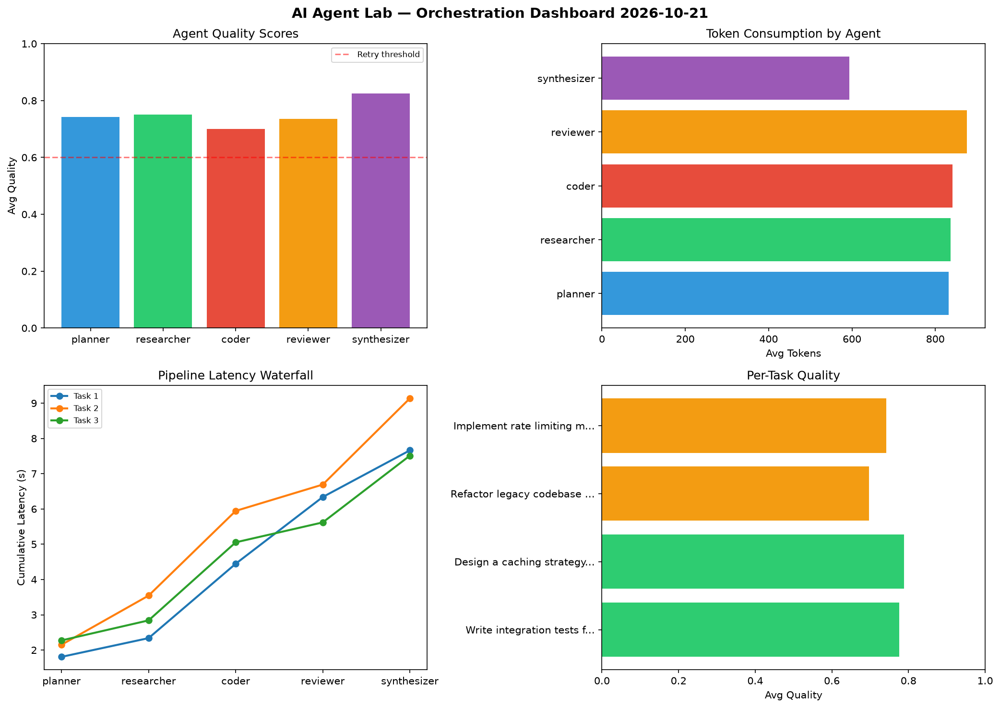

# AI Agent Lab — Orchestration Report 2026-10-21

**Run ID:** `09bde80e8e` | **Tasks:** 4 | **Avg Quality:** 0.751

## Aggregate Metrics

| Metric | Value |
|--------|-------|
| avg_latency | 7.549 |
| total_tokens | 15915 |
| avg_quality | 0.751 |

## Delta vs Yesterday

| Metric | Today | Yesterday | Change |
|--------|-------|-----------|--------|
| avg_latency | 7.549 | 5.881 | 📈 28.4% |
| total_tokens | 15915 | 13706 | 📈 16.1% |
| avg_quality | 0.751 | 0.726 | 📈 3.4% |

## Pipeline Results

### Write integration tests for payment processing module
| Agent | Quality | Latency | Tokens | Status |
|-------|---------|---------|--------|--------|
| planner | 0.785 | 1.807s | 873 | success |
| researcher | 0.866 | 0.531s | 660 | success |
| coder | 0.531 | 2.109s | 958 | needs_retry |
| reviewer | 0.851 | 1.892s | 1198 | success |
| synthesizer | 0.847 | 1.323s | 472 | success |

### Design a caching strategy for high-traffic endpoints
| Agent | Quality | Latency | Tokens | Status |
|-------|---------|---------|--------|--------|
| planner | 0.785 | 2.15s | 1043 | success |
| researcher | 0.807 | 1.394s | 909 | success |
| coder | 0.979 | 2.401s | 1071 | success |
| reviewer | 0.612 | 0.747s | 920 | success |
| synthesizer | 0.759 | 2.444s | 322 | success |

### Refactor legacy codebase to use dependency injection
| Agent | Quality | Latency | Tokens | Status |
|-------|---------|---------|--------|--------|
| planner | 0.517 | 2.273s | 677 | needs_retry |
| researcher | 0.702 | 0.568s | 1237 | success |
| coder | 0.572 | 2.213s | 885 | needs_retry |
| reviewer | 0.789 | 0.565s | 1039 | success |
| synthesizer | 0.904 | 1.892s | 836 | success |

### Implement rate limiting middleware
| Agent | Quality | Latency | Tokens | Status |
|-------|---------|---------|--------|--------|
| planner | 0.884 | 2.138s | 733 | success |
| researcher | 0.628 | 1.786s | 541 | success |
| coder | 0.717 | 0.165s | 451 | success |
| reviewer | 0.689 | 0.914s | 346 | success |
| synthesizer | 0.792 | 0.883s | 744 | success |
