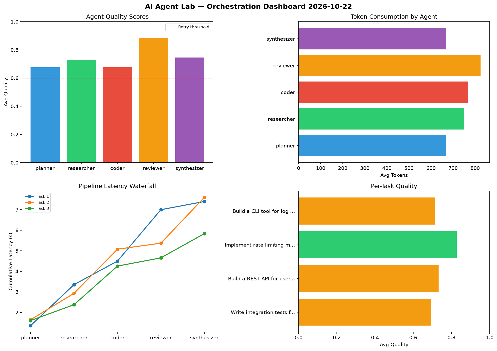

# AI Agent Lab — Orchestration Report 2026-10-22

**Run ID:** `aaaadc7426` | **Tasks:** 4 | **Avg Quality:** 0.742

## Aggregate Metrics

| Metric | Value |
|--------|-------|
| avg_latency | 6.958 |
| total_tokens | 14728 |
| avg_quality | 0.742 |

## Delta vs Yesterday

| Metric | Today | Yesterday | Change |
|--------|-------|-----------|--------|
| avg_latency | 6.958 | 5.812 | 📈 19.7% |
| total_tokens | 14728 | 13720 | 📈 7.3% |
| avg_quality | 0.742 | 0.743 | 📉 -0.1% |

## Pipeline Results

### Write integration tests for payment processing module
| Agent | Quality | Latency | Tokens | Status |
|-------|---------|---------|--------|--------|
| planner | 0.583 | 1.358s | 906 | needs_retry |
| researcher | 0.525 | 1.995s | 623 | needs_retry |
| coder | 0.662 | 1.144s | 769 | success |
| reviewer | 0.985 | 2.5s | 885 | success |
| synthesizer | 0.716 | 0.399s | 1085 | success |

### Build a REST API for user authentication
| Agent | Quality | Latency | Tokens | Status |
|-------|---------|---------|--------|--------|
| planner | 0.784 | 1.645s | 370 | success |
| researcher | 0.811 | 1.285s | 1051 | success |
| coder | 0.556 | 2.146s | 472 | needs_retry |
| reviewer | 0.975 | 0.294s | 590 | success |
| synthesizer | 0.538 | 2.221s | 625 | needs_retry |

### Implement rate limiting middleware
| Agent | Quality | Latency | Tokens | Status |
|-------|---------|---------|--------|--------|
| planner | 0.699 | 1.606s | 644 | success |
| researcher | 0.746 | 0.771s | 952 | success |
| coder | 0.925 | 1.877s | 1067 | success |
| reviewer | 0.798 | 0.401s | 685 | success |
| synthesizer | 0.97 | 1.177s | 612 | success |

### Build a CLI tool for log analysis
| Agent | Quality | Latency | Tokens | Status |
|-------|---------|---------|--------|--------|
| planner | 0.64 | 2.337s | 758 | success |
| researcher | 0.826 | 0.413s | 375 | success |
| coder | 0.563 | 0.153s | 766 | needs_retry |
| reviewer | 0.785 | 2.163s | 1138 | success |
| synthesizer | 0.758 | 1.946s | 355 | success |
