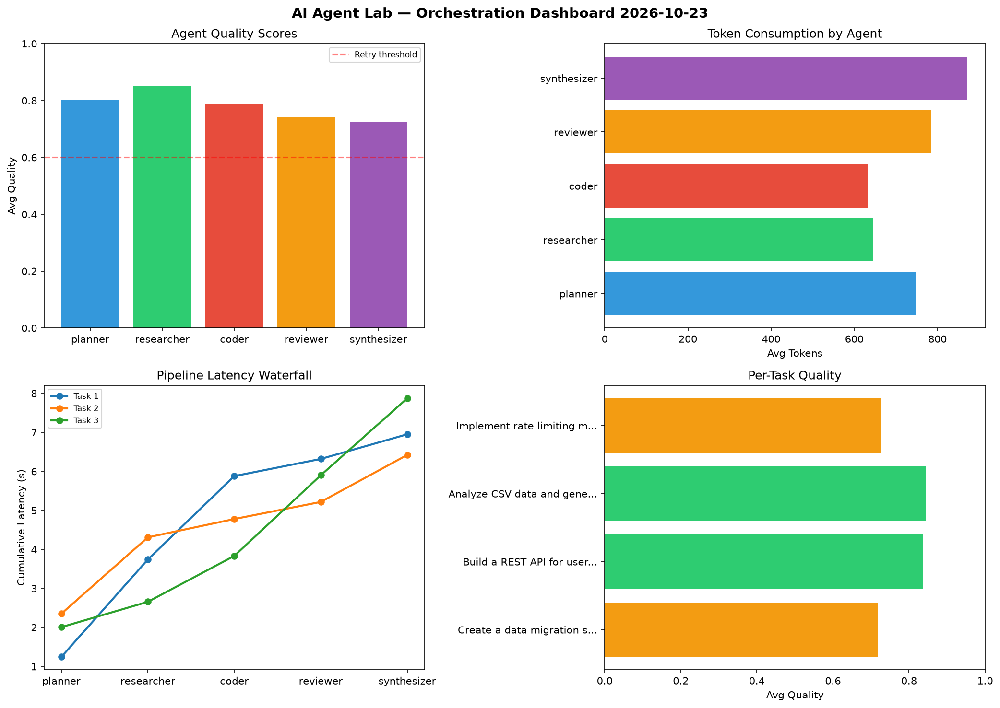

# AI Agent Lab — Orchestration Report 2026-10-23

**Run ID:** `a101ffa120` | **Tasks:** 4 | **Avg Quality:** 0.782

## Aggregate Metrics

| Metric | Value |
|--------|-------|
| avg_latency | 7.092 |
| total_tokens | 14731 |
| avg_quality | 0.782 |

## Delta vs Yesterday

| Metric | Today | Yesterday | Change |
|--------|-------|-----------|--------|
| avg_latency | 7.092 | 5.278 | 📈 34.4% |
| total_tokens | 14731 | 14161 | 📈 4.0% |
| avg_quality | 0.782 | 0.77 | 📈 1.6% |

## Pipeline Results

### Create a data migration script for schema v2
| Agent | Quality | Latency | Tokens | Status |
|-------|---------|---------|--------|--------|
| planner | 0.944 | 1.246s | 664 | success |
| researcher | 0.903 | 2.496s | 773 | success |
| coder | 0.513 | 2.137s | 301 | needs_retry |
| reviewer | 0.636 | 0.44s | 507 | success |
| synthesizer | 0.593 | 0.632s | 918 | needs_retry |

### Build a REST API for user authentication
| Agent | Quality | Latency | Tokens | Status |
|-------|---------|---------|--------|--------|
| planner | 0.911 | 2.353s | 774 | success |
| researcher | 0.852 | 1.957s | 536 | success |
| coder | 0.896 | 0.469s | 481 | success |
| reviewer | 0.629 | 0.438s | 808 | success |
| synthesizer | 0.895 | 1.205s | 567 | success |

### Analyze CSV data and generate statistical summary
| Agent | Quality | Latency | Tokens | Status |
|-------|---------|---------|--------|--------|
| planner | 0.803 | 2.008s | 956 | success |
| researcher | 0.926 | 0.649s | 752 | success |
| coder | 0.929 | 1.177s | 695 | success |
| reviewer | 0.954 | 2.067s | 721 | success |
| synthesizer | 0.609 | 1.971s | 747 | success |

### Implement rate limiting middleware
| Agent | Quality | Latency | Tokens | Status |
|-------|---------|---------|--------|--------|
| planner | 0.551 | 2.259s | 598 | needs_retry |
| researcher | 0.726 | 1.575s | 522 | success |
| coder | 0.819 | 1.585s | 1055 | success |
| reviewer | 0.745 | 0.736s | 1104 | success |
| synthesizer | 0.8 | 0.968s | 1252 | success |
