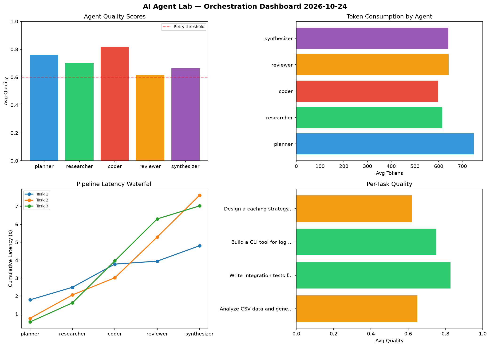

# AI Agent Lab — Orchestration Report 2026-10-24

**Run ID:** `81c548e6f5` | **Tasks:** 4 | **Avg Quality:** 0.712

## Aggregate Metrics

| Metric | Value |
|--------|-------|
| avg_latency | 5.935 |
| total_tokens | 12982 |
| avg_quality | 0.712 |

## Delta vs Yesterday

| Metric | Today | Yesterday | Change |
|--------|-------|-----------|--------|
| avg_latency | 5.935 | 6.61 | 📉 -10.2% |
| total_tokens | 12982 | 12421 | 📈 4.5% |
| avg_quality | 0.712 | 0.742 | 📉 -4.0% |

## Pipeline Results

### Analyze CSV data and generate statistical summary
| Agent | Quality | Latency | Tokens | Status |
|-------|---------|---------|--------|--------|
| planner | 0.61 | 1.793s | 1020 | success |
| researcher | 0.716 | 0.699s | 962 | success |
| coder | 0.759 | 1.289s | 350 | success |
| reviewer | 0.6 | 0.165s | 842 | needs_retry |
| synthesizer | 0.559 | 0.858s | 645 | needs_retry |

### Write integration tests for payment processing module
| Agent | Quality | Latency | Tokens | Status |
|-------|---------|---------|--------|--------|
| planner | 0.981 | 0.767s | 422 | success |
| researcher | 0.968 | 1.3s | 470 | success |
| coder | 0.847 | 0.955s | 572 | success |
| reviewer | 0.524 | 2.266s | 467 | needs_retry |
| synthesizer | 0.816 | 2.328s | 567 | success |

### Build a CLI tool for log analysis
| Agent | Quality | Latency | Tokens | Status |
|-------|---------|---------|--------|--------|
| planner | 0.83 | 0.561s | 1001 | success |
| researcher | 0.518 | 1.063s | 634 | needs_retry |
| coder | 0.967 | 2.339s | 437 | success |
| reviewer | 0.831 | 2.335s | 345 | success |
| synthesizer | 0.616 | 0.725s | 884 | success |

### Design a caching strategy for high-traffic endpoints
| Agent | Quality | Latency | Tokens | Status |
|-------|---------|---------|--------|--------|
| planner | 0.615 | 0.789s | 551 | success |
| researcher | 0.607 | 0.896s | 397 | success |
| coder | 0.698 | 0.434s | 1034 | success |
| reviewer | 0.511 | 0.325s | 915 | needs_retry |
| synthesizer | 0.671 | 1.853s | 467 | success |
