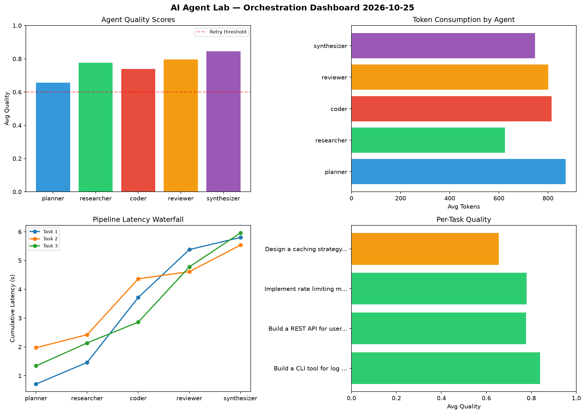

# AI Agent Lab — Orchestration Report 2026-10-25

**Run ID:** `8860b9c4aa` | **Tasks:** 4 | **Avg Quality:** 0.763

## Aggregate Metrics

| Metric | Value |
|--------|-------|
| avg_latency | 6.212 |
| total_tokens | 15437 |
| avg_quality | 0.763 |

## Delta vs Yesterday

| Metric | Today | Yesterday | Change |
|--------|-------|-----------|--------|
| avg_latency | 6.212 | 5.525 | 📈 12.4% |
| total_tokens | 15437 | 14823 | 📈 4.1% |
| avg_quality | 0.763 | 0.737 | 📈 3.5% |

## Pipeline Results

### Build a CLI tool for log analysis
| Agent | Quality | Latency | Tokens | Status |
|-------|---------|---------|--------|--------|
| planner | 0.837 | 0.708s | 1009 | success |
| researcher | 0.652 | 0.753s | 974 | success |
| coder | 0.8 | 2.255s | 1025 | success |
| reviewer | 0.977 | 1.665s | 928 | success |
| synthesizer | 0.931 | 0.421s | 873 | success |

### Build a REST API for user authentication
| Agent | Quality | Latency | Tokens | Status |
|-------|---------|---------|--------|--------|
| planner | 0.63 | 1.972s | 1051 | success |
| researcher | 0.669 | 0.452s | 662 | success |
| coder | 0.85 | 1.941s | 1168 | success |
| reviewer | 0.806 | 0.249s | 537 | success |
| synthesizer | 0.923 | 0.923s | 471 | success |

### Implement rate limiting middleware
| Agent | Quality | Latency | Tokens | Status |
|-------|---------|---------|--------|--------|
| planner | 0.587 | 1.34s | 801 | needs_retry |
| researcher | 0.927 | 0.797s | 245 | success |
| coder | 0.744 | 0.723s | 347 | success |
| reviewer | 0.667 | 1.921s | 810 | success |
| synthesizer | 0.972 | 1.178s | 802 | success |

### Design a caching strategy for high-traffic endpoints
| Agent | Quality | Latency | Tokens | Status |
|-------|---------|---------|--------|--------|
| planner | 0.574 | 1.377s | 625 | needs_retry |
| researcher | 0.856 | 0.121s | 618 | success |
| coder | 0.563 | 1.673s | 717 | needs_retry |
| reviewer | 0.732 | 2.107s | 930 | success |
| synthesizer | 0.553 | 2.272s | 844 | needs_retry |
