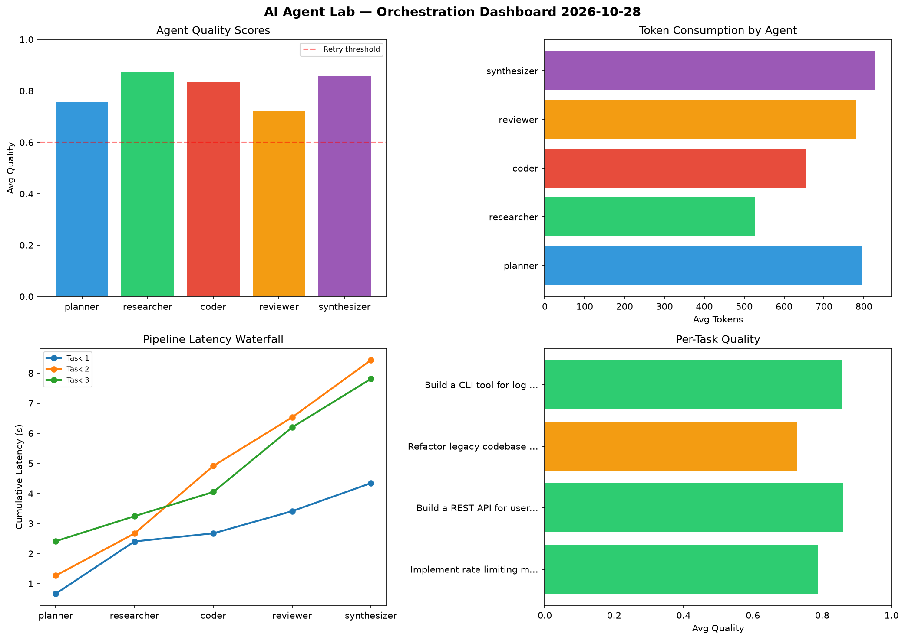

# AI Agent Lab — Orchestration Report 2026-10-28

**Run ID:** `5ce228b48e` | **Tasks:** 4 | **Avg Quality:** 0.808

## Aggregate Metrics

| Metric | Value |
|--------|-------|
| avg_latency | 6.994 |
| total_tokens | 14349 |
| avg_quality | 0.808 |

## Delta vs Yesterday

| Metric | Today | Yesterday | Change |
|--------|-------|-----------|--------|
| avg_latency | 6.994 | 6.96 | 📈 0.5% |
| total_tokens | 14349 | 13918 | 📈 3.1% |
| avg_quality | 0.808 | 0.746 | 📈 8.3% |

## Pipeline Results

### Implement rate limiting middleware
| Agent | Quality | Latency | Tokens | Status |
|-------|---------|---------|--------|--------|
| planner | 0.603 | 0.662s | 866 | success |
| researcher | 0.899 | 1.741s | 745 | success |
| coder | 0.966 | 0.269s | 697 | success |
| reviewer | 0.675 | 0.739s | 936 | success |
| synthesizer | 0.799 | 0.93s | 1039 | success |

### Build a REST API for user authentication
| Agent | Quality | Latency | Tokens | Status |
|-------|---------|---------|--------|--------|
| planner | 0.887 | 1.266s | 976 | success |
| researcher | 0.765 | 1.402s | 696 | success |
| coder | 0.952 | 2.246s | 534 | success |
| reviewer | 0.935 | 1.618s | 701 | success |
| synthesizer | 0.764 | 1.903s | 1229 | success |

### Refactor legacy codebase to use dependency injection
| Agent | Quality | Latency | Tokens | Status |
|-------|---------|---------|--------|--------|
| planner | 0.544 | 2.41s | 404 | needs_retry |
| researcher | 0.988 | 0.833s | 333 | success |
| coder | 0.521 | 0.804s | 628 | needs_retry |
| reviewer | 0.615 | 2.152s | 724 | success |
| synthesizer | 0.966 | 1.611s | 374 | success |

### Build a CLI tool for log analysis
| Agent | Quality | Latency | Tokens | Status |
|-------|---------|---------|--------|--------|
| planner | 0.992 | 1.786s | 929 | success |
| researcher | 0.837 | 0.679s | 335 | success |
| coder | 0.901 | 1.62s | 767 | success |
| reviewer | 0.655 | 2.245s | 766 | success |
| synthesizer | 0.906 | 1.061s | 670 | success |
