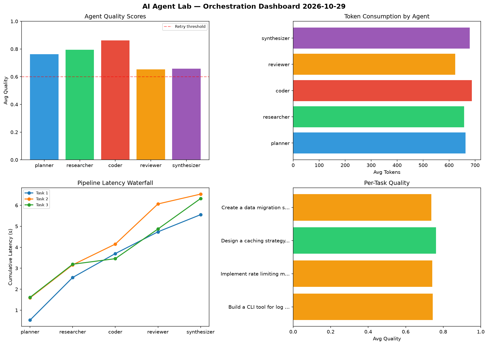

# AI Agent Lab — Orchestration Report 2026-10-29

**Run ID:** `e7e2a4b2f6` | **Tasks:** 4 | **Avg Quality:** 0.746

## Aggregate Metrics

| Metric | Value |
|--------|-------|
| avg_latency | 6.275 |
| total_tokens | 13250 |
| avg_quality | 0.746 |

## Delta vs Yesterday

| Metric | Today | Yesterday | Change |
|--------|-------|-----------|--------|
| avg_latency | 6.275 | 6.226 | 📈 0.8% |
| total_tokens | 13250 | 12914 | 📈 2.6% |
| avg_quality | 0.746 | 0.749 | 📉 -0.4% |

## Pipeline Results

### Build a CLI tool for log analysis
| Agent | Quality | Latency | Tokens | Status |
|-------|---------|---------|--------|--------|
| planner | 0.686 | 0.529s | 806 | success |
| researcher | 0.786 | 2.031s | 910 | success |
| coder | 0.943 | 1.14s | 394 | success |
| reviewer | 0.647 | 1.036s | 455 | success |
| synthesizer | 0.66 | 0.818s | 910 | success |

### Implement rate limiting middleware
| Agent | Quality | Latency | Tokens | Status |
|-------|---------|---------|--------|--------|
| planner | 0.739 | 1.588s | 772 | success |
| researcher | 0.904 | 1.574s | 760 | success |
| coder | 0.746 | 0.99s | 926 | success |
| reviewer | 0.711 | 1.913s | 707 | success |
| synthesizer | 0.606 | 0.469s | 739 | success |

### Design a caching strategy for high-traffic endpoints
| Agent | Quality | Latency | Tokens | Status |
|-------|---------|---------|--------|--------|
| planner | 0.939 | 1.612s | 450 | success |
| researcher | 0.645 | 1.579s | 511 | success |
| coder | 0.876 | 0.266s | 951 | success |
| reviewer | 0.558 | 1.414s | 451 | needs_retry |
| synthesizer | 0.792 | 1.452s | 336 | success |

### Create a data migration script for schema v2
| Agent | Quality | Latency | Tokens | Status |
|-------|---------|---------|--------|--------|
| planner | 0.686 | 0.518s | 626 | success |
| researcher | 0.846 | 1.668s | 451 | success |
| coder | 0.88 | 1.28s | 479 | success |
| reviewer | 0.697 | 1.74s | 883 | success |
| synthesizer | 0.574 | 1.483s | 733 | needs_retry |
