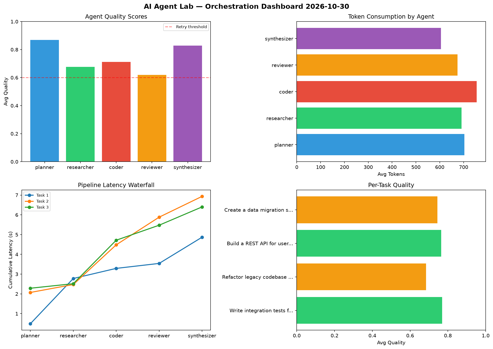

# AI Agent Lab — Orchestration Report 2026-10-30

**Run ID:** `44613f74ad` | **Tasks:** 4 | **Avg Quality:** 0.741

## Aggregate Metrics

| Metric | Value |
|--------|-------|
| avg_latency | 6.544 |
| total_tokens | 13717 |
| avg_quality | 0.741 |

## Delta vs Yesterday

| Metric | Today | Yesterday | Change |
|--------|-------|-----------|--------|
| avg_latency | 6.544 | 6.275 | 📈 4.3% |
| total_tokens | 13717 | 13250 | 📈 3.5% |
| avg_quality | 0.741 | 0.746 | 📉 -0.7% |

## Pipeline Results

### Write integration tests for payment processing module
| Agent | Quality | Latency | Tokens | Status |
|-------|---------|---------|--------|--------|
| planner | 0.933 | 0.486s | 516 | success |
| researcher | 0.739 | 2.292s | 570 | success |
| coder | 0.682 | 0.512s | 877 | success |
| reviewer | 0.6 | 0.251s | 462 | needs_retry |
| synthesizer | 0.898 | 1.327s | 435 | success |

### Refactor legacy codebase to use dependency injection
| Agent | Quality | Latency | Tokens | Status |
|-------|---------|---------|--------|--------|
| planner | 0.657 | 2.071s | 800 | success |
| researcher | 0.541 | 0.402s | 985 | needs_retry |
| coder | 0.707 | 2.009s | 723 | success |
| reviewer | 0.648 | 1.4s | 953 | success |
| synthesizer | 0.874 | 1.053s | 599 | success |

### Build a REST API for user authentication
| Agent | Quality | Latency | Tokens | Status |
|-------|---------|---------|--------|--------|
| planner | 0.927 | 2.285s | 665 | success |
| researcher | 0.845 | 0.23s | 622 | success |
| coder | 0.921 | 2.2s | 860 | success |
| reviewer | 0.527 | 0.76s | 686 | needs_retry |
| synthesizer | 0.604 | 0.926s | 779 | success |

### Create a data migration script for schema v2
| Agent | Quality | Latency | Tokens | Status |
|-------|---------|---------|--------|--------|
| planner | 0.96 | 1.752s | 831 | success |
| researcher | 0.583 | 2.325s | 590 | needs_retry |
| coder | 0.541 | 0.516s | 560 | needs_retry |
| reviewer | 0.7 | 1.257s | 596 | success |
| synthesizer | 0.935 | 2.122s | 608 | success |
