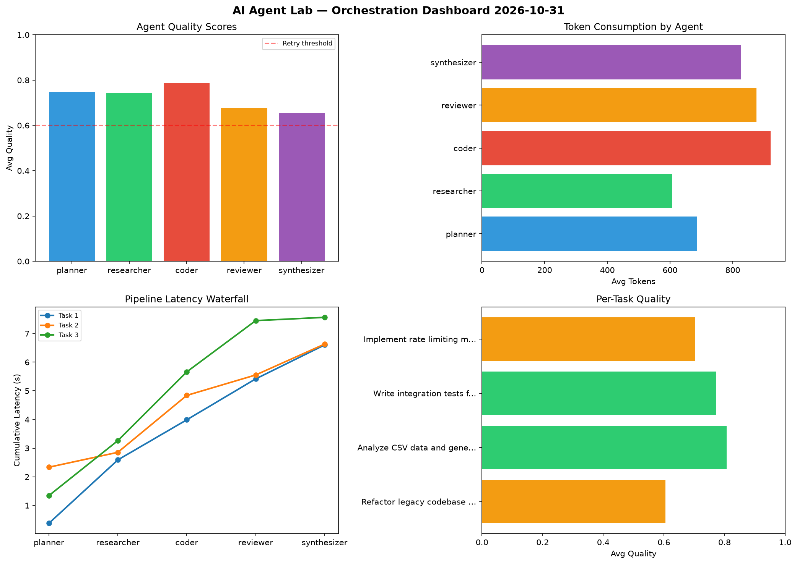

# AI Agent Lab — Orchestration Report 2026-10-31

**Run ID:** `4d5a726dd5` | **Tasks:** 4 | **Avg Quality:** 0.715

## Aggregate Metrics

| Metric | Value |
|--------|-------|
| avg_latency | 6.551 |
| total_tokens | 13140 |
| avg_quality | 0.715 |

## Delta vs Yesterday

| Metric | Today | Yesterday | Change |
|--------|-------|-----------|--------|
| avg_latency | 6.551 | 5.436 | 📈 20.5% |
| total_tokens | 13140 | 13957 | 📉 -5.9% |
| avg_quality | 0.715 | 0.709 | 📈 0.8% |

## Pipeline Results

### Design a caching strategy for high-traffic endpoints
| Agent | Quality | Latency | Tokens | Status |
|-------|---------|---------|--------|--------|
| planner | 0.811 | 2.158s | 683 | success |
| researcher | 0.74 | 0.832s | 1094 | success |
| coder | 0.52 | 0.777s | 515 | needs_retry |
| reviewer | 0.812 | 1.0s | 499 | success |
| synthesizer | 0.785 | 0.58s | 575 | success |

### Build a REST API for user authentication
| Agent | Quality | Latency | Tokens | Status |
|-------|---------|---------|--------|--------|
| planner | 0.75 | 2.09s | 1062 | success |
| researcher | 0.5 | 2.231s | 362 | needs_retry |
| coder | 0.606 | 0.293s | 1070 | success |
| reviewer | 0.746 | 0.647s | 728 | success |
| synthesizer | 0.686 | 2.313s | 383 | success |

### Build a CLI tool for log analysis
| Agent | Quality | Latency | Tokens | Status |
|-------|---------|---------|--------|--------|
| planner | 0.563 | 0.716s | 498 | needs_retry |
| researcher | 0.716 | 2.353s | 1119 | success |
| coder | 0.834 | 1.073s | 916 | success |
| reviewer | 0.685 | 0.571s | 164 | success |
| synthesizer | 0.724 | 1.103s | 501 | success |

### Create a data migration script for schema v2
| Agent | Quality | Latency | Tokens | Status |
|-------|---------|---------|--------|--------|
| planner | 0.722 | 2.001s | 534 | success |
| researcher | 0.983 | 0.896s | 991 | success |
| coder | 0.777 | 2.253s | 581 | success |
| reviewer | 0.683 | 1.23s | 459 | success |
| synthesizer | 0.656 | 1.089s | 406 | success |
