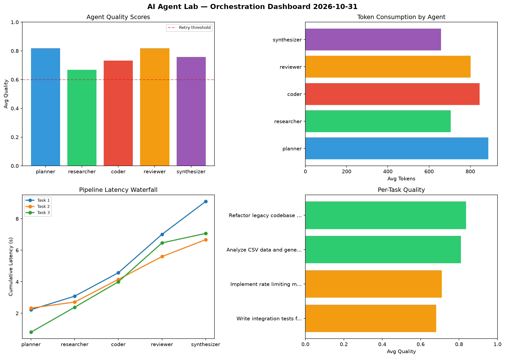

# AI Agent Lab — Orchestration Report 2026-10-31

**Run ID:** `09137c5a0e` | **Tasks:** 4 | **Avg Quality:** 0.759

## Aggregate Metrics

| Metric | Value |
|--------|-------|
| avg_latency | 7.702 |
| total_tokens | 15587 |
| avg_quality | 0.759 |

## Delta vs Yesterday

| Metric | Today | Yesterday | Change |
|--------|-------|-----------|--------|
| avg_latency | 7.702 | 5.436 | 📈 41.7% |
| total_tokens | 15587 | 13957 | 📈 11.7% |
| avg_quality | 0.759 | 0.709 | 📈 7.1% |

## Pipeline Results

### Write integration tests for payment processing module
| Agent | Quality | Latency | Tokens | Status |
|-------|---------|---------|--------|--------|
| planner | 0.562 | 2.227s | 400 | needs_retry |
| researcher | 0.636 | 0.859s | 434 | success |
| coder | 0.68 | 1.487s | 470 | success |
| reviewer | 0.819 | 2.437s | 382 | success |
| synthesizer | 0.709 | 2.088s | 275 | success |

### Implement rate limiting middleware
| Agent | Quality | Latency | Tokens | Status |
|-------|---------|---------|--------|--------|
| planner | 0.914 | 2.33s | 1074 | success |
| researcher | 0.86 | 0.384s | 894 | success |
| coder | 0.573 | 1.439s | 1133 | needs_retry |
| reviewer | 0.63 | 1.449s | 1141 | success |
| synthesizer | 0.574 | 1.071s | 731 | needs_retry |

### Analyze CSV data and generate statistical summary
| Agent | Quality | Latency | Tokens | Status |
|-------|---------|---------|--------|--------|
| planner | 0.943 | 0.803s | 1138 | success |
| researcher | 0.538 | 1.581s | 682 | needs_retry |
| coder | 0.848 | 1.614s | 800 | success |
| reviewer | 0.917 | 2.469s | 1222 | success |
| synthesizer | 0.8 | 0.603s | 797 | success |

### Refactor legacy codebase to use dependency injection
| Agent | Quality | Latency | Tokens | Status |
|-------|---------|---------|--------|--------|
| planner | 0.857 | 0.836s | 938 | success |
| researcher | 0.636 | 1.859s | 809 | success |
| coder | 0.83 | 1.389s | 978 | success |
| reviewer | 0.908 | 1.486s | 461 | success |
| synthesizer | 0.948 | 2.397s | 828 | success |
