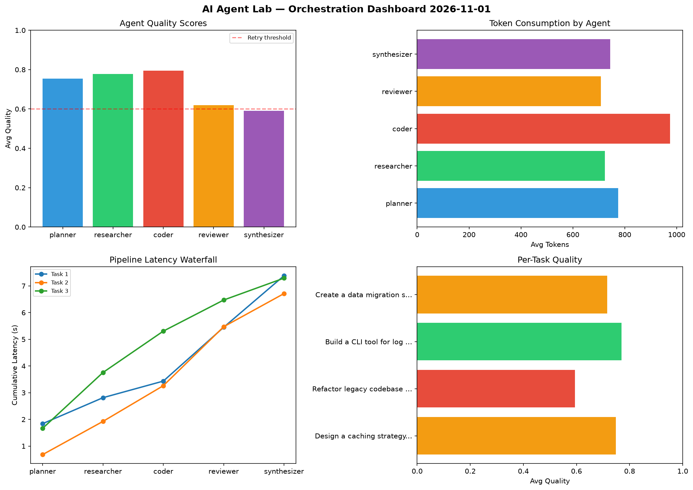

# AI Agent Lab — Orchestration Report 2026-11-01

**Run ID:** `0e52a09681` | **Tasks:** 4 | **Avg Quality:** 0.707

## Aggregate Metrics

| Metric | Value |
|--------|-------|
| avg_latency | 7.027 |
| total_tokens | 15696 |
| avg_quality | 0.707 |

## Delta vs Yesterday

| Metric | Today | Yesterday | Change |
|--------|-------|-----------|--------|
| avg_latency | 7.027 | 7.266 | 📉 -3.3% |
| total_tokens | 15696 | 15376 | 📈 2.1% |
| avg_quality | 0.707 | 0.755 | 📉 -6.4% |

## Pipeline Results

### Design a caching strategy for high-traffic endpoints
| Agent | Quality | Latency | Tokens | Status |
|-------|---------|---------|--------|--------|
| planner | 0.98 | 1.84s | 784 | success |
| researcher | 0.809 | 0.973s | 822 | success |
| coder | 0.889 | 0.622s | 947 | success |
| reviewer | 0.535 | 2.016s | 358 | needs_retry |
| synthesizer | 0.529 | 1.932s | 858 | needs_retry |

### Refactor legacy codebase to use dependency injection
| Agent | Quality | Latency | Tokens | Status |
|-------|---------|---------|--------|--------|
| planner | 0.6 | 0.681s | 756 | needs_retry |
| researcher | 0.694 | 1.244s | 1015 | success |
| coder | 0.515 | 1.338s | 1095 | needs_retry |
| reviewer | 0.657 | 2.208s | 715 | success |
| synthesizer | 0.502 | 1.243s | 804 | needs_retry |

### Build a CLI tool for log analysis
| Agent | Quality | Latency | Tokens | Status |
|-------|---------|---------|--------|--------|
| planner | 0.725 | 1.665s | 945 | success |
| researcher | 0.831 | 2.092s | 392 | success |
| coder | 0.879 | 1.55s | 1048 | success |
| reviewer | 0.678 | 1.165s | 938 | success |
| synthesizer | 0.737 | 0.82s | 685 | success |

### Create a data migration script for schema v2
| Agent | Quality | Latency | Tokens | Status |
|-------|---------|---------|--------|--------|
| planner | 0.709 | 2.339s | 612 | success |
| researcher | 0.777 | 0.28s | 667 | success |
| coder | 0.894 | 1.766s | 808 | success |
| reviewer | 0.606 | 0.786s | 821 | success |
| synthesizer | 0.592 | 1.548s | 626 | needs_retry |
