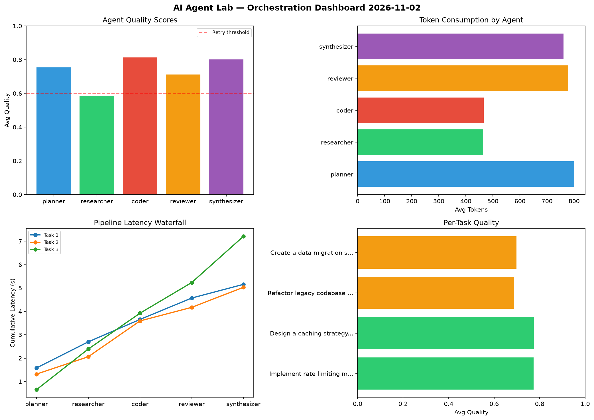

# AI Agent Lab — Orchestration Report 2026-11-02

**Run ID:** `b8535f38a9` | **Tasks:** 4 | **Avg Quality:** 0.733

## Aggregate Metrics

| Metric | Value |
|--------|-------|
| avg_latency | 6.493 |
| total_tokens | 13081 |
| avg_quality | 0.733 |

## Delta vs Yesterday

| Metric | Today | Yesterday | Change |
|--------|-------|-----------|--------|
| avg_latency | 6.493 | 7.027 | 📉 -7.6% |
| total_tokens | 13081 | 15696 | 📉 -16.7% |
| avg_quality | 0.733 | 0.707 | 📈 3.7% |

## Pipeline Results

### Implement rate limiting middleware
| Agent | Quality | Latency | Tokens | Status |
|-------|---------|---------|--------|--------|
| planner | 0.884 | 1.583s | 930 | success |
| researcher | 0.667 | 1.115s | 505 | success |
| coder | 0.918 | 0.957s | 282 | success |
| reviewer | 0.645 | 0.916s | 884 | success |
| synthesizer | 0.753 | 0.585s | 817 | success |

### Design a caching strategy for high-traffic endpoints
| Agent | Quality | Latency | Tokens | Status |
|-------|---------|---------|--------|--------|
| planner | 0.577 | 1.319s | 661 | needs_retry |
| researcher | 0.559 | 0.742s | 439 | needs_retry |
| coder | 0.987 | 1.531s | 511 | success |
| reviewer | 0.754 | 0.581s | 508 | success |
| synthesizer | 0.994 | 0.857s | 656 | success |

### Refactor legacy codebase to use dependency injection
| Agent | Quality | Latency | Tokens | Status |
|-------|---------|---------|--------|--------|
| planner | 0.844 | 0.653s | 724 | success |
| researcher | 0.541 | 1.737s | 738 | needs_retry |
| coder | 0.746 | 1.533s | 742 | success |
| reviewer | 0.748 | 1.311s | 1055 | success |
| synthesizer | 0.555 | 1.976s | 973 | needs_retry |

### Create a data migration script for schema v2
| Agent | Quality | Latency | Tokens | Status |
|-------|---------|---------|--------|--------|
| planner | 0.714 | 1.196s | 889 | success |
| researcher | 0.571 | 2.032s | 174 | needs_retry |
| coder | 0.603 | 0.72s | 331 | success |
| reviewer | 0.698 | 2.179s | 665 | success |
| synthesizer | 0.903 | 2.45s | 597 | success |
