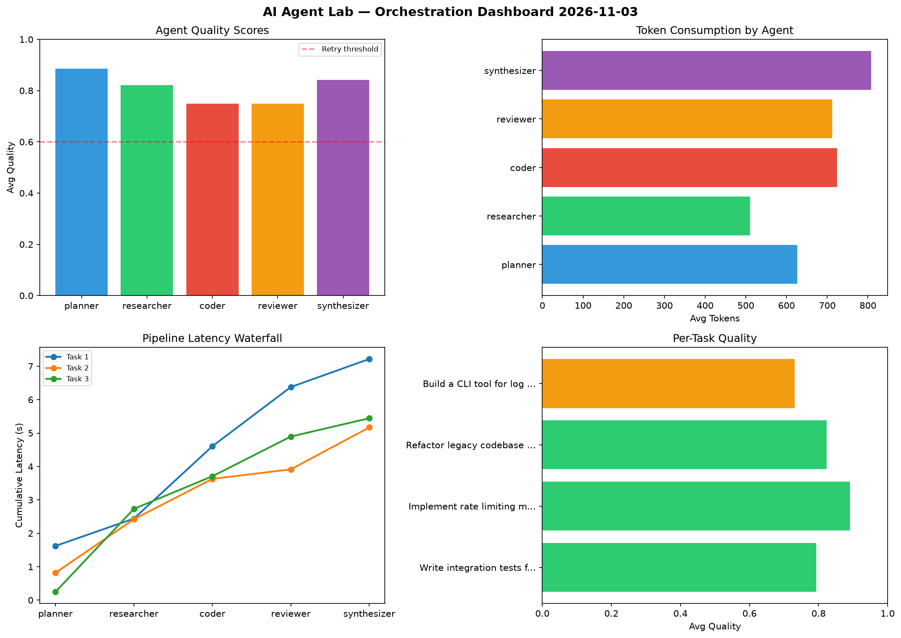

# AI Agent Lab — Orchestration Report 2026-11-03

**Run ID:** `2256a852a5` | **Tasks:** 4 | **Avg Quality:** 0.809

## Aggregate Metrics

| Metric | Value |
|--------|-------|
| avg_latency | 6.235 |
| total_tokens | 13527 |
| avg_quality | 0.809 |

## Delta vs Yesterday

| Metric | Today | Yesterday | Change |
|--------|-------|-----------|--------|
| avg_latency | 6.235 | 6.493 | 📉 -4.0% |
| total_tokens | 13527 | 13081 | 📈 3.4% |
| avg_quality | 0.809 | 0.733 | 📈 10.4% |

## Pipeline Results

### Write integration tests for payment processing module
| Agent | Quality | Latency | Tokens | Status |
|-------|---------|---------|--------|--------|
| planner | 0.897 | 1.622s | 207 | success |
| researcher | 0.641 | 0.818s | 361 | success |
| coder | 0.588 | 2.166s | 735 | needs_retry |
| reviewer | 0.927 | 1.772s | 992 | success |
| synthesizer | 0.912 | 0.84s | 617 | success |

### Implement rate limiting middleware
| Agent | Quality | Latency | Tokens | Status |
|-------|---------|---------|--------|--------|
| planner | 0.87 | 0.817s | 456 | success |
| researcher | 0.937 | 1.605s | 504 | success |
| coder | 0.917 | 1.207s | 879 | success |
| reviewer | 0.766 | 0.285s | 896 | success |
| synthesizer | 0.965 | 1.256s | 829 | success |

### Refactor legacy codebase to use dependency injection
| Agent | Quality | Latency | Tokens | Status |
|-------|---------|---------|--------|--------|
| planner | 0.907 | 0.246s | 656 | success |
| researcher | 0.812 | 2.486s | 523 | success |
| coder | 0.713 | 0.975s | 705 | success |
| reviewer | 0.79 | 1.189s | 323 | success |
| synthesizer | 0.891 | 0.548s | 678 | success |

### Build a CLI tool for log analysis
| Agent | Quality | Latency | Tokens | Status |
|-------|---------|---------|--------|--------|
| planner | 0.868 | 2.458s | 1188 | success |
| researcher | 0.899 | 1.157s | 654 | success |
| coder | 0.775 | 2.214s | 578 | success |
| reviewer | 0.512 | 1.12s | 638 | needs_retry |
| synthesizer | 0.6 | 0.159s | 1108 | needs_retry |
