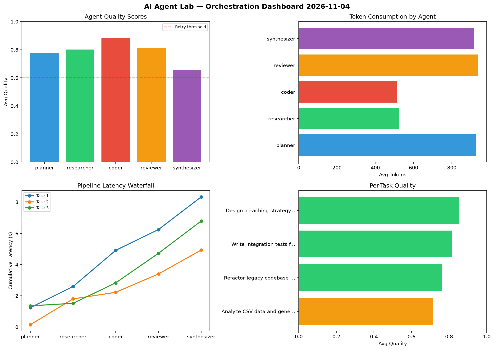

# AI Agent Lab — Orchestration Report 2026-11-04

**Run ID:** `c6f0a35aba` | **Tasks:** 4 | **Avg Quality:** 0.787

## Aggregate Metrics

| Metric | Value |
|--------|-------|
| avg_latency | 7.089 |
| total_tokens | 15265 |
| avg_quality | 0.787 |

## Delta vs Yesterday

| Metric | Today | Yesterday | Change |
|--------|-------|-----------|--------|
| avg_latency | 7.089 | 6.235 | 📈 13.7% |
| total_tokens | 15265 | 13527 | 📈 12.8% |
| avg_quality | 0.787 | 0.809 | 📉 -2.7% |

## Pipeline Results

### Analyze CSV data and generate statistical summary
| Agent | Quality | Latency | Tokens | Status |
|-------|---------|---------|--------|--------|
| planner | 0.532 | 1.243s | 846 | needs_retry |
| researcher | 0.734 | 1.349s | 569 | success |
| coder | 0.839 | 2.322s | 385 | success |
| reviewer | 0.883 | 1.33s | 834 | success |
| synthesizer | 0.583 | 2.088s | 1223 | needs_retry |

### Refactor legacy codebase to use dependency injection
| Agent | Quality | Latency | Tokens | Status |
|-------|---------|---------|--------|--------|
| planner | 0.938 | 0.148s | 888 | success |
| researcher | 0.871 | 1.654s | 326 | success |
| coder | 0.753 | 0.422s | 413 | success |
| reviewer | 0.672 | 1.176s | 1071 | success |
| synthesizer | 0.576 | 1.531s | 937 | needs_retry |

### Write integration tests for payment processing module
| Agent | Quality | Latency | Tokens | Status |
|-------|---------|---------|--------|--------|
| planner | 0.701 | 1.357s | 1190 | success |
| researcher | 0.71 | 0.161s | 443 | success |
| coder | 0.984 | 1.313s | 514 | success |
| reviewer | 0.906 | 1.891s | 619 | success |
| synthesizer | 0.777 | 2.069s | 909 | success |

### Design a caching strategy for high-traffic endpoints
| Agent | Quality | Latency | Tokens | Status |
|-------|---------|---------|--------|--------|
| planner | 0.929 | 2.303s | 786 | success |
| researcher | 0.89 | 0.274s | 754 | success |
| coder | 0.964 | 0.943s | 745 | success |
| reviewer | 0.801 | 2.346s | 1218 | success |
| synthesizer | 0.691 | 2.435s | 595 | success |
