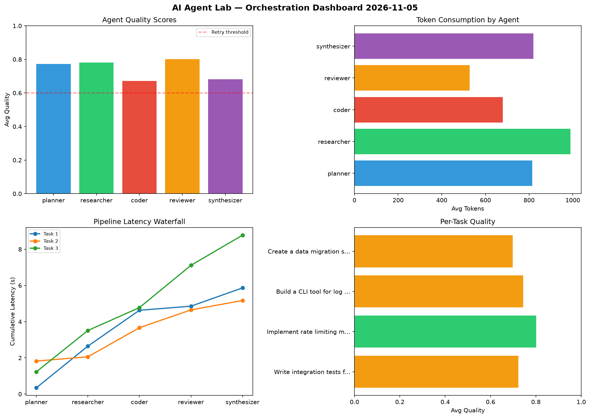

# AI Agent Lab — Orchestration Report 2026-11-05

**Run ID:** `d08751fcdf` | **Tasks:** 4 | **Avg Quality:** 0.741

## Aggregate Metrics

| Metric | Value |
|--------|-------|
| avg_latency | 6.805 |
| total_tokens | 15324 |
| avg_quality | 0.741 |

## Delta vs Yesterday

| Metric | Today | Yesterday | Change |
|--------|-------|-----------|--------|
| avg_latency | 6.805 | 7.438 | 📉 -8.5% |
| total_tokens | 15324 | 14566 | 📈 5.2% |
| avg_quality | 0.741 | 0.757 | 📉 -2.1% |

## Pipeline Results

### Write integration tests for payment processing module
| Agent | Quality | Latency | Tokens | Status |
|-------|---------|---------|--------|--------|
| planner | 0.748 | 0.346s | 824 | success |
| researcher | 0.949 | 2.303s | 945 | success |
| coder | 0.642 | 1.979s | 621 | success |
| reviewer | 0.766 | 0.227s | 601 | success |
| synthesizer | 0.512 | 1.01s | 704 | needs_retry |

### Implement rate limiting middleware
| Agent | Quality | Latency | Tokens | Status |
|-------|---------|---------|--------|--------|
| planner | 0.942 | 1.824s | 775 | success |
| researcher | 0.914 | 0.235s | 991 | success |
| coder | 0.539 | 1.607s | 505 | needs_retry |
| reviewer | 0.918 | 0.983s | 487 | success |
| synthesizer | 0.691 | 0.519s | 855 | success |

### Build a CLI tool for log analysis
| Agent | Quality | Latency | Tokens | Status |
|-------|---------|---------|--------|--------|
| planner | 0.863 | 1.229s | 539 | success |
| researcher | 0.57 | 2.282s | 931 | needs_retry |
| coder | 0.728 | 1.265s | 506 | success |
| reviewer | 0.772 | 2.337s | 778 | success |
| synthesizer | 0.786 | 1.664s | 940 | success |

### Create a data migration script for schema v2
| Agent | Quality | Latency | Tokens | Status |
|-------|---------|---------|--------|--------|
| planner | 0.541 | 1.098s | 1120 | needs_retry |
| researcher | 0.69 | 2.155s | 1091 | success |
| coder | 0.774 | 2.349s | 1085 | success |
| reviewer | 0.749 | 0.998s | 245 | success |
| synthesizer | 0.738 | 0.808s | 781 | success |
