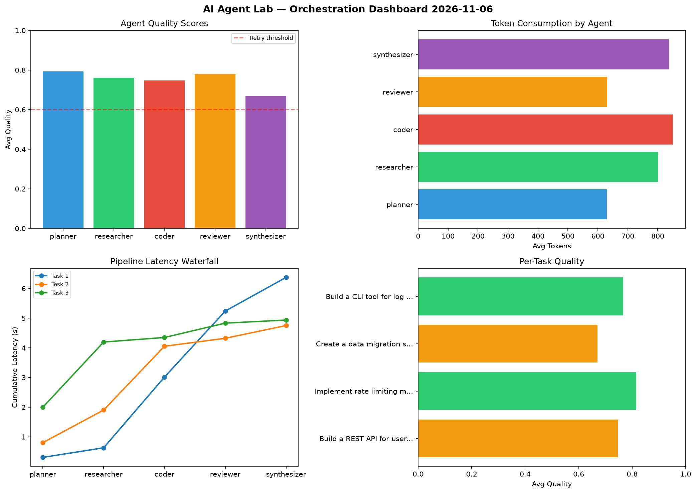

# AI Agent Lab — Orchestration Report 2026-11-06

**Run ID:** `9a33b5cbdf` | **Tasks:** 4 | **Avg Quality:** 0.75

## Aggregate Metrics

| Metric | Value |
|--------|-------|
| avg_latency | 5.755 |
| total_tokens | 15003 |
| avg_quality | 0.75 |

## Delta vs Yesterday

| Metric | Today | Yesterday | Change |
|--------|-------|-----------|--------|
| avg_latency | 5.755 | 7.351 | 📉 -21.7% |
| total_tokens | 15003 | 13653 | 📈 9.9% |
| avg_quality | 0.75 | 0.738 | 📈 1.6% |

## Pipeline Results

### Build a REST API for user authentication
| Agent | Quality | Latency | Tokens | Status |
|-------|---------|---------|--------|--------|
| planner | 0.82 | 0.306s | 894 | success |
| researcher | 0.842 | 0.323s | 769 | success |
| coder | 0.897 | 2.384s | 963 | success |
| reviewer | 0.519 | 2.226s | 841 | needs_retry |
| synthesizer | 0.659 | 1.135s | 747 | success |

### Implement rate limiting middleware
| Agent | Quality | Latency | Tokens | Status |
|-------|---------|---------|--------|--------|
| planner | 0.971 | 0.803s | 775 | success |
| researcher | 0.85 | 1.099s | 672 | success |
| coder | 0.845 | 2.15s | 354 | success |
| reviewer | 0.74 | 0.269s | 577 | success |
| synthesizer | 0.667 | 0.43s | 916 | success |

### Create a data migration script for schema v2
| Agent | Quality | Latency | Tokens | Status |
|-------|---------|---------|--------|--------|
| planner | 0.668 | 1.997s | 344 | success |
| researcher | 0.503 | 2.198s | 950 | needs_retry |
| coder | 0.609 | 0.153s | 1058 | success |
| reviewer | 0.975 | 0.484s | 834 | success |
| synthesizer | 0.599 | 0.104s | 778 | needs_retry |

### Build a CLI tool for log analysis
| Agent | Quality | Latency | Tokens | Status |
|-------|---------|---------|--------|--------|
| planner | 0.712 | 1.141s | 508 | success |
| researcher | 0.85 | 2.03s | 814 | success |
| coder | 0.639 | 2.317s | 1028 | success |
| reviewer | 0.886 | 0.469s | 273 | success |
| synthesizer | 0.747 | 1.001s | 908 | success |
