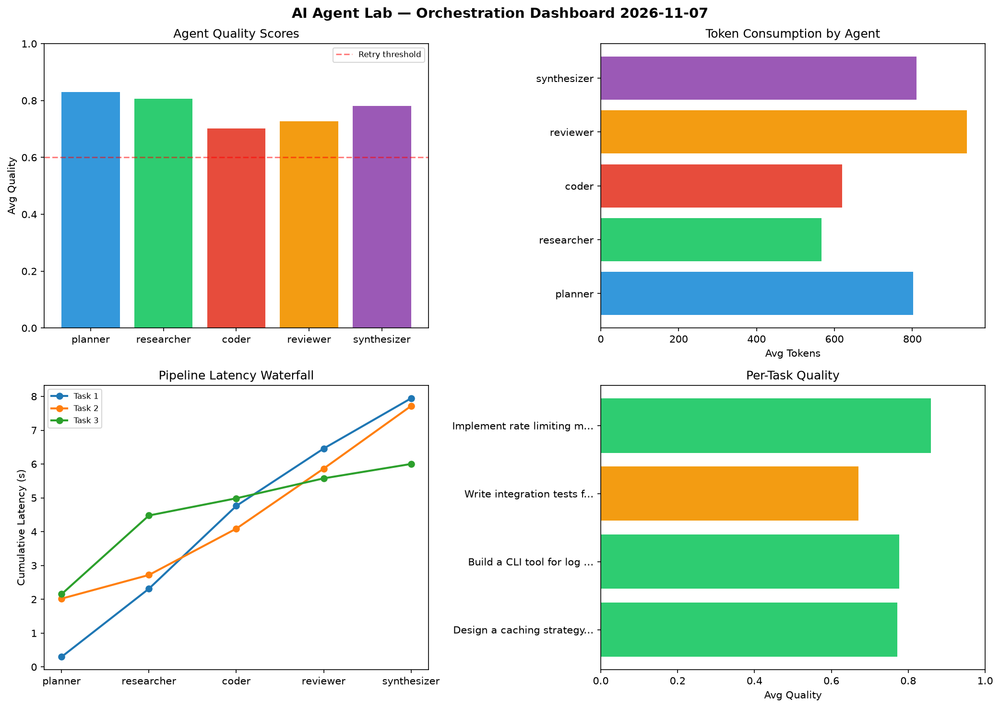

# AI Agent Lab — Orchestration Report 2026-11-07

**Run ID:** `9ea202b7ff` | **Tasks:** 4 | **Avg Quality:** 0.77

## Aggregate Metrics

| Metric | Value |
|--------|-------|
| avg_latency | 6.614 |
| total_tokens | 14961 |
| avg_quality | 0.77 |

## Delta vs Yesterday

| Metric | Today | Yesterday | Change |
|--------|-------|-----------|--------|
| avg_latency | 6.614 | 5.438 | 📈 21.6% |
| total_tokens | 14961 | 14996 | 📉 -0.2% |
| avg_quality | 0.77 | 0.808 | 📉 -4.7% |

## Pipeline Results

### Design a caching strategy for high-traffic endpoints
| Agent | Quality | Latency | Tokens | Status |
|-------|---------|---------|--------|--------|
| planner | 0.974 | 0.299s | 624 | success |
| researcher | 0.754 | 2.015s | 925 | success |
| coder | 0.663 | 2.448s | 1077 | success |
| reviewer | 0.713 | 1.696s | 827 | success |
| synthesizer | 0.754 | 1.484s | 1245 | success |

### Build a CLI tool for log analysis
| Agent | Quality | Latency | Tokens | Status |
|-------|---------|---------|--------|--------|
| planner | 0.986 | 2.02s | 601 | success |
| researcher | 0.677 | 0.7s | 254 | success |
| coder | 0.722 | 1.37s | 512 | success |
| reviewer | 0.656 | 1.775s | 1243 | success |
| synthesizer | 0.837 | 1.85s | 838 | success |

### Write integration tests for payment processing module
| Agent | Quality | Latency | Tokens | Status |
|-------|---------|---------|--------|--------|
| planner | 0.504 | 2.153s | 991 | needs_retry |
| researcher | 0.843 | 2.326s | 382 | success |
| coder | 0.84 | 0.508s | 611 | success |
| reviewer | 0.632 | 0.59s | 896 | success |
| synthesizer | 0.537 | 0.425s | 378 | needs_retry |

### Implement rate limiting middleware
| Agent | Quality | Latency | Tokens | Status |
|-------|---------|---------|--------|--------|
| planner | 0.854 | 1.86s | 994 | success |
| researcher | 0.953 | 0.866s | 708 | success |
| coder | 0.582 | 0.173s | 280 | needs_retry |
| reviewer | 0.906 | 1.614s | 793 | success |
| synthesizer | 0.998 | 0.285s | 782 | success |
