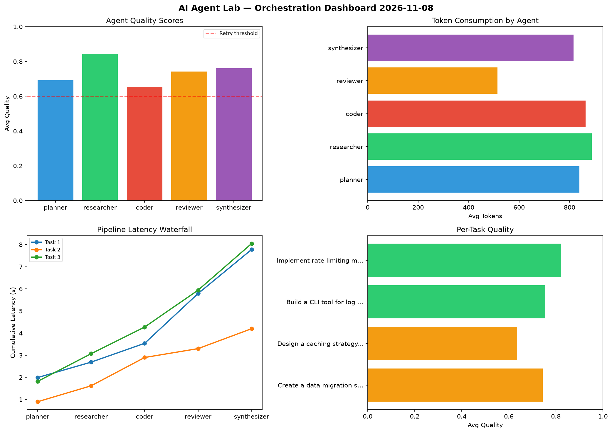

# AI Agent Lab — Orchestration Report 2026-11-08

**Run ID:** `0548d5e5e4` | **Tasks:** 4 | **Avg Quality:** 0.739

## Aggregate Metrics

| Metric | Value |
|--------|-------|
| avg_latency | 6.809 |
| total_tokens | 15685 |
| avg_quality | 0.739 |

## Delta vs Yesterday

| Metric | Today | Yesterday | Change |
|--------|-------|-----------|--------|
| avg_latency | 6.809 | 6.29 | 📈 8.3% |
| total_tokens | 15685 | 15663 | 📈 0.1% |
| avg_quality | 0.739 | 0.79 | 📉 -6.5% |

## Pipeline Results

### Create a data migration script for schema v2
| Agent | Quality | Latency | Tokens | Status |
|-------|---------|---------|--------|--------|
| planner | 0.594 | 1.991s | 823 | needs_retry |
| researcher | 0.977 | 0.697s | 745 | success |
| coder | 0.688 | 0.85s | 763 | success |
| reviewer | 0.667 | 2.251s | 797 | success |
| synthesizer | 0.793 | 1.988s | 736 | success |

### Design a caching strategy for high-traffic endpoints
| Agent | Quality | Latency | Tokens | Status |
|-------|---------|---------|--------|--------|
| planner | 0.615 | 0.898s | 871 | success |
| researcher | 0.506 | 0.72s | 861 | needs_retry |
| coder | 0.656 | 1.279s | 852 | success |
| reviewer | 0.739 | 0.402s | 453 | success |
| synthesizer | 0.659 | 0.899s | 683 | success |

### Build a CLI tool for log analysis
| Agent | Quality | Latency | Tokens | Status |
|-------|---------|---------|--------|--------|
| planner | 0.577 | 1.818s | 1144 | needs_retry |
| researcher | 0.914 | 1.251s | 975 | success |
| coder | 0.622 | 1.204s | 841 | success |
| reviewer | 0.817 | 1.668s | 237 | success |
| synthesizer | 0.842 | 2.104s | 951 | success |

### Implement rate limiting middleware
| Agent | Quality | Latency | Tokens | Status |
|-------|---------|---------|--------|--------|
| planner | 0.983 | 0.444s | 518 | success |
| researcher | 0.983 | 1.131s | 970 | success |
| coder | 0.654 | 1.323s | 1000 | success |
| reviewer | 0.746 | 2.328s | 571 | success |
| synthesizer | 0.75 | 1.991s | 894 | success |
