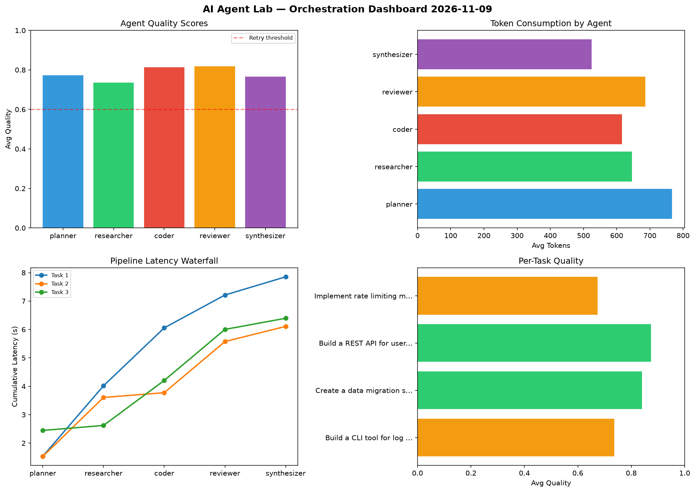

# AI Agent Lab — Orchestration Report 2026-11-09

**Run ID:** `a39b7d9d63` | **Tasks:** 4 | **Avg Quality:** 0.781

## Aggregate Metrics

| Metric | Value |
|--------|-------|
| avg_latency | 5.846 |
| total_tokens | 12959 |
| avg_quality | 0.781 |

## Delta vs Yesterday

| Metric | Today | Yesterday | Change |
|--------|-------|-----------|--------|
| avg_latency | 5.846 | 6.064 | 📉 -3.6% |
| total_tokens | 12959 | 15929 | 📉 -18.6% |
| avg_quality | 0.781 | 0.773 | 📈 1.0% |

## Pipeline Results

### Build a CLI tool for log analysis
| Agent | Quality | Latency | Tokens | Status |
|-------|---------|---------|--------|--------|
| planner | 0.591 | 1.535s | 665 | needs_retry |
| researcher | 0.773 | 2.482s | 627 | success |
| coder | 0.872 | 2.039s | 431 | success |
| reviewer | 0.918 | 1.158s | 879 | success |
| synthesizer | 0.529 | 0.64s | 327 | needs_retry |

### Create a data migration script for schema v2
| Agent | Quality | Latency | Tokens | Status |
|-------|---------|---------|--------|--------|
| planner | 0.689 | 1.529s | 593 | success |
| researcher | 0.888 | 2.078s | 720 | success |
| coder | 0.707 | 0.167s | 852 | success |
| reviewer | 0.96 | 1.801s | 581 | success |
| synthesizer | 0.956 | 0.534s | 622 | success |

### Build a REST API for user authentication
| Agent | Quality | Latency | Tokens | Status |
|-------|---------|---------|--------|--------|
| planner | 0.863 | 2.445s | 939 | success |
| researcher | 0.768 | 0.176s | 284 | success |
| coder | 0.959 | 1.584s | 850 | success |
| reviewer | 0.877 | 1.798s | 675 | success |
| synthesizer | 0.902 | 0.392s | 765 | success |

### Implement rate limiting middleware
| Agent | Quality | Latency | Tokens | Status |
|-------|---------|---------|--------|--------|
| planner | 0.951 | 0.457s | 869 | success |
| researcher | 0.511 | 0.259s | 955 | needs_retry |
| coder | 0.716 | 1.352s | 330 | success |
| reviewer | 0.516 | 0.751s | 612 | needs_retry |
| synthesizer | 0.675 | 0.208s | 383 | success |
