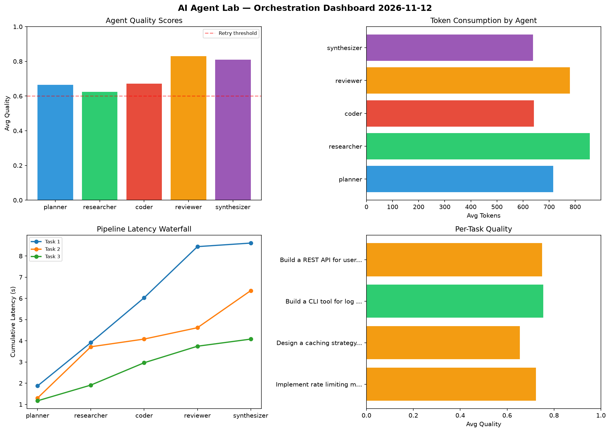

# AI Agent Lab — Orchestration Report 2026-11-12

**Run ID:** `9d38688e4c` | **Tasks:** 4 | **Avg Quality:** 0.72

## Aggregate Metrics

| Metric | Value |
|--------|-------|
| avg_latency | 5.934 |
| total_tokens | 14525 |
| avg_quality | 0.72 |

## Delta vs Yesterday

| Metric | Today | Yesterday | Change |
|--------|-------|-----------|--------|
| avg_latency | 5.934 | 6.13 | 📉 -3.2% |
| total_tokens | 14525 | 14708 | 📉 -1.2% |
| avg_quality | 0.72 | 0.767 | 📉 -6.1% |

## Pipeline Results

### Implement rate limiting middleware
| Agent | Quality | Latency | Tokens | Status |
|-------|---------|---------|--------|--------|
| planner | 0.722 | 1.871s | 781 | success |
| researcher | 0.62 | 2.044s | 1111 | success |
| coder | 0.512 | 2.115s | 248 | needs_retry |
| reviewer | 0.918 | 2.411s | 779 | success |
| synthesizer | 0.841 | 0.168s | 697 | success |

### Design a caching strategy for high-traffic endpoints
| Agent | Quality | Latency | Tokens | Status |
|-------|---------|---------|--------|--------|
| planner | 0.715 | 1.3s | 842 | success |
| researcher | 0.549 | 2.417s | 888 | needs_retry |
| coder | 0.521 | 0.364s | 1090 | needs_retry |
| reviewer | 0.693 | 0.535s | 823 | success |
| synthesizer | 0.792 | 1.749s | 1156 | success |

### Build a CLI tool for log analysis
| Agent | Quality | Latency | Tokens | Status |
|-------|---------|---------|--------|--------|
| planner | 0.689 | 1.169s | 817 | success |
| researcher | 0.696 | 0.741s | 742 | success |
| coder | 0.864 | 1.053s | 707 | success |
| reviewer | 0.888 | 0.78s | 645 | success |
| synthesizer | 0.635 | 0.336s | 456 | success |

### Build a REST API for user authentication
| Agent | Quality | Latency | Tokens | Status |
|-------|---------|---------|--------|--------|
| planner | 0.535 | 1.369s | 422 | needs_retry |
| researcher | 0.629 | 0.457s | 682 | success |
| coder | 0.786 | 0.277s | 523 | success |
| reviewer | 0.824 | 0.963s | 870 | success |
| synthesizer | 0.971 | 1.615s | 246 | success |
