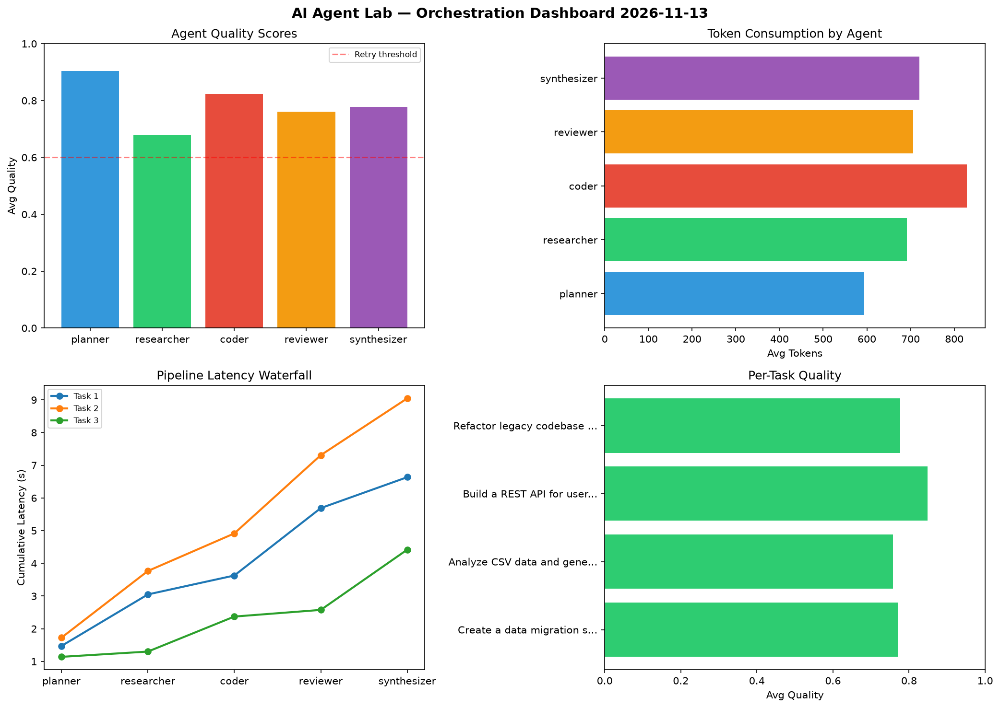

# AI Agent Lab — Orchestration Report 2026-11-13

**Run ID:** `83854429c4` | **Tasks:** 4 | **Avg Quality:** 0.789

## Aggregate Metrics

| Metric | Value |
|--------|-------|
| avg_latency | 6.528 |
| total_tokens | 14160 |
| avg_quality | 0.789 |

## Delta vs Yesterday

| Metric | Today | Yesterday | Change |
|--------|-------|-----------|--------|
| avg_latency | 6.528 | 6.098 | 📈 7.1% |
| total_tokens | 14160 | 14359 | 📉 -1.4% |
| avg_quality | 0.789 | 0.804 | 📉 -1.9% |

## Pipeline Results

### Create a data migration script for schema v2
| Agent | Quality | Latency | Tokens | Status |
|-------|---------|---------|--------|--------|
| planner | 0.965 | 1.473s | 575 | success |
| researcher | 0.758 | 1.577s | 679 | success |
| coder | 0.825 | 0.579s | 1012 | success |
| reviewer | 0.616 | 2.062s | 1025 | success |
| synthesizer | 0.692 | 0.945s | 1142 | success |

### Analyze CSV data and generate statistical summary
| Agent | Quality | Latency | Tokens | Status |
|-------|---------|---------|--------|--------|
| planner | 0.843 | 1.726s | 792 | success |
| researcher | 0.572 | 2.041s | 540 | needs_retry |
| coder | 0.721 | 1.149s | 651 | success |
| reviewer | 0.888 | 2.394s | 711 | success |
| synthesizer | 0.765 | 1.737s | 232 | success |

### Build a REST API for user authentication
| Agent | Quality | Latency | Tokens | Status |
|-------|---------|---------|--------|--------|
| planner | 0.891 | 1.141s | 385 | success |
| researcher | 0.665 | 0.161s | 393 | success |
| coder | 0.858 | 1.071s | 683 | success |
| reviewer | 0.96 | 0.204s | 328 | success |
| synthesizer | 0.87 | 1.843s | 997 | success |

### Refactor legacy codebase to use dependency injection
| Agent | Quality | Latency | Tokens | Status |
|-------|---------|---------|--------|--------|
| planner | 0.915 | 1.468s | 623 | success |
| researcher | 0.718 | 2.038s | 1153 | success |
| coder | 0.889 | 0.624s | 971 | success |
| reviewer | 0.581 | 1.168s | 758 | needs_retry |
| synthesizer | 0.781 | 0.712s | 510 | success |
