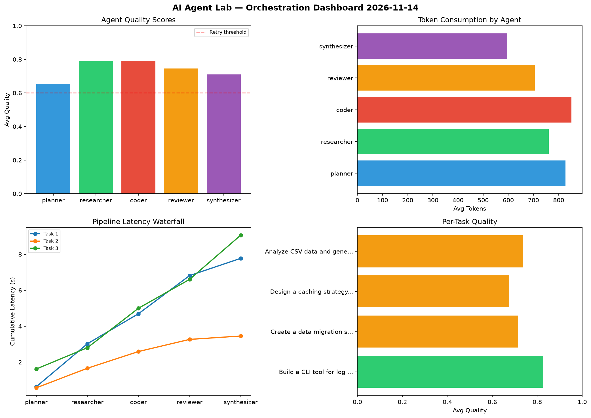

# AI Agent Lab — Orchestration Report 2026-11-14

**Run ID:** `3319003afc` | **Tasks:** 4 | **Avg Quality:** 0.738

## Aggregate Metrics

| Metric | Value |
|--------|-------|
| avg_latency | 6.731 |
| total_tokens | 14963 |
| avg_quality | 0.738 |

## Delta vs Yesterday

| Metric | Today | Yesterday | Change |
|--------|-------|-----------|--------|
| avg_latency | 6.731 | 6.528 | 📈 3.1% |
| total_tokens | 14963 | 14160 | 📈 5.7% |
| avg_quality | 0.738 | 0.789 | 📉 -6.5% |

## Pipeline Results

### Build a CLI tool for log analysis
| Agent | Quality | Latency | Tokens | Status |
|-------|---------|---------|--------|--------|
| planner | 0.795 | 0.63s | 822 | success |
| researcher | 0.88 | 2.392s | 991 | success |
| coder | 0.977 | 1.672s | 585 | success |
| reviewer | 0.806 | 2.123s | 469 | success |
| synthesizer | 0.676 | 0.96s | 310 | success |

### Create a data migration script for schema v2
| Agent | Quality | Latency | Tokens | Status |
|-------|---------|---------|--------|--------|
| planner | 0.513 | 0.569s | 799 | needs_retry |
| researcher | 0.779 | 1.089s | 817 | success |
| coder | 0.838 | 0.931s | 804 | success |
| reviewer | 0.777 | 0.675s | 961 | success |
| synthesizer | 0.67 | 0.189s | 630 | success |

### Design a caching strategy for high-traffic endpoints
| Agent | Quality | Latency | Tokens | Status |
|-------|---------|---------|--------|--------|
| planner | 0.775 | 1.616s | 671 | success |
| researcher | 0.815 | 1.185s | 420 | success |
| coder | 0.52 | 2.199s | 1054 | needs_retry |
| reviewer | 0.547 | 1.606s | 385 | needs_retry |
| synthesizer | 0.713 | 2.461s | 475 | success |

### Analyze CSV data and generate statistical summary
| Agent | Quality | Latency | Tokens | Status |
|-------|---------|---------|--------|--------|
| planner | 0.538 | 0.93s | 1015 | needs_retry |
| researcher | 0.683 | 1.571s | 817 | success |
| coder | 0.828 | 1.521s | 962 | success |
| reviewer | 0.852 | 1.937s | 1007 | success |
| synthesizer | 0.784 | 0.667s | 969 | success |
