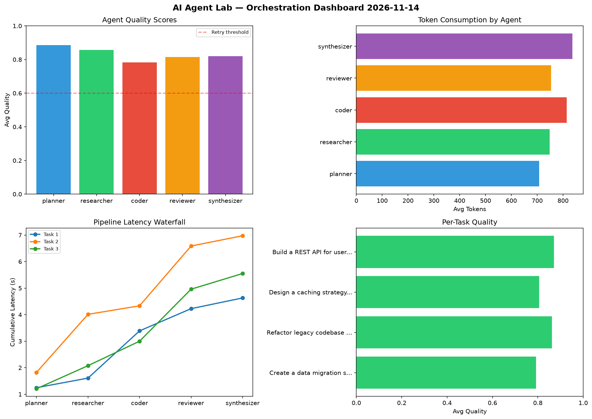

# AI Agent Lab — Orchestration Report 2026-11-14

**Run ID:** `996946efad` | **Tasks:** 4 | **Avg Quality:** 0.833

## Aggregate Metrics

| Metric | Value |
|--------|-------|
| avg_latency | 5.527 |
| total_tokens | 15440 |
| avg_quality | 0.833 |

## Delta vs Yesterday

| Metric | Today | Yesterday | Change |
|--------|-------|-----------|--------|
| avg_latency | 5.527 | 6.528 | 📉 -15.3% |
| total_tokens | 15440 | 14160 | 📈 9.0% |
| avg_quality | 0.833 | 0.789 | 📈 5.6% |

## Pipeline Results

### Create a data migration script for schema v2
| Agent | Quality | Latency | Tokens | Status |
|-------|---------|---------|--------|--------|
| planner | 0.828 | 1.246s | 561 | success |
| researcher | 0.775 | 0.362s | 875 | success |
| coder | 0.51 | 1.78s | 913 | needs_retry |
| reviewer | 0.922 | 0.838s | 945 | success |
| synthesizer | 0.923 | 0.404s | 968 | success |

### Refactor legacy codebase to use dependency injection
| Agent | Quality | Latency | Tokens | Status |
|-------|---------|---------|--------|--------|
| planner | 0.768 | 1.821s | 1006 | success |
| researcher | 0.987 | 2.191s | 935 | success |
| coder | 0.923 | 0.321s | 762 | success |
| reviewer | 0.943 | 2.254s | 632 | success |
| synthesizer | 0.687 | 0.387s | 648 | success |

### Design a caching strategy for high-traffic endpoints
| Agent | Quality | Latency | Tokens | Status |
|-------|---------|---------|--------|--------|
| planner | 0.949 | 1.208s | 514 | success |
| researcher | 0.768 | 0.868s | 596 | success |
| coder | 0.758 | 0.923s | 684 | success |
| reviewer | 0.57 | 1.961s | 691 | needs_retry |
| synthesizer | 0.983 | 0.591s | 683 | success |

### Build a REST API for user authentication
| Agent | Quality | Latency | Tokens | Status |
|-------|---------|---------|--------|--------|
| planner | 0.998 | 0.258s | 748 | success |
| researcher | 0.9 | 1.96s | 589 | success |
| coder | 0.941 | 2.032s | 897 | success |
| reviewer | 0.825 | 0.479s | 747 | success |
| synthesizer | 0.689 | 0.223s | 1046 | success |
