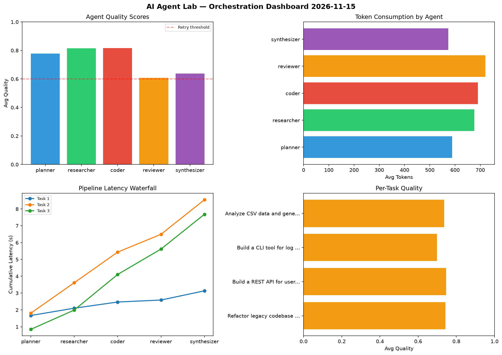

# AI Agent Lab — Orchestration Report 2026-11-15

**Run ID:** `3d25782a22` | **Tasks:** 4 | **Avg Quality:** 0.731

## Aggregate Metrics

| Metric | Value |
|--------|-------|
| avg_latency | 6.351 |
| total_tokens | 13000 |
| avg_quality | 0.731 |

## Delta vs Yesterday

| Metric | Today | Yesterday | Change |
|--------|-------|-----------|--------|
| avg_latency | 6.351 | 6.731 | 📉 -5.6% |
| total_tokens | 13000 | 14963 | 📉 -13.1% |
| avg_quality | 0.731 | 0.738 | 📉 -0.9% |

## Pipeline Results

### Refactor legacy codebase to use dependency injection
| Agent | Quality | Latency | Tokens | Status |
|-------|---------|---------|--------|--------|
| planner | 0.861 | 1.669s | 785 | success |
| researcher | 0.809 | 0.434s | 647 | success |
| coder | 0.718 | 0.367s | 789 | success |
| reviewer | 0.656 | 0.119s | 332 | success |
| synthesizer | 0.67 | 0.546s | 870 | success |

### Build a REST API for user authentication
| Agent | Quality | Latency | Tokens | Status |
|-------|---------|---------|--------|--------|
| planner | 0.711 | 1.809s | 558 | success |
| researcher | 0.936 | 1.806s | 577 | success |
| coder | 0.868 | 1.82s | 657 | success |
| reviewer | 0.686 | 1.061s | 711 | success |
| synthesizer | 0.527 | 2.053s | 379 | needs_retry |

### Build a CLI tool for log analysis
| Agent | Quality | Latency | Tokens | Status |
|-------|---------|---------|--------|--------|
| planner | 0.792 | 0.846s | 503 | success |
| researcher | 0.634 | 1.146s | 771 | success |
| coder | 0.699 | 2.115s | 704 | success |
| reviewer | 0.531 | 1.512s | 1221 | needs_retry |
| synthesizer | 0.838 | 2.066s | 689 | success |

### Analyze CSV data and generate statistical summary
| Agent | Quality | Latency | Tokens | Status |
|-------|---------|---------|--------|--------|
| planner | 0.746 | 2.233s | 507 | success |
| researcher | 0.88 | 0.797s | 712 | success |
| coder | 0.984 | 1.1s | 614 | success |
| reviewer | 0.558 | 0.305s | 618 | needs_retry |
| synthesizer | 0.513 | 1.601s | 356 | needs_retry |
