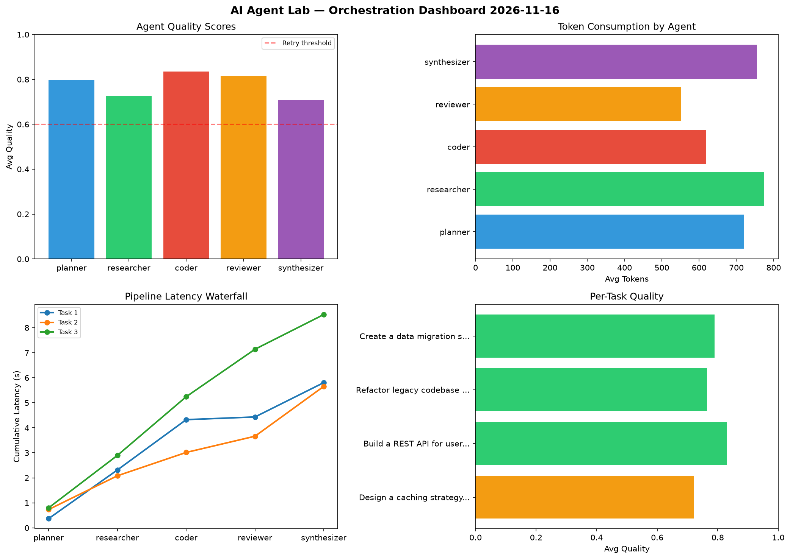

# AI Agent Lab — Orchestration Report 2026-11-16

**Run ID:** `3f1d3a1f7f` | **Tasks:** 4 | **Avg Quality:** 0.776

## Aggregate Metrics

| Metric | Value |
|--------|-------|
| avg_latency | 7.173 |
| total_tokens | 13678 |
| avg_quality | 0.776 |

## Delta vs Yesterday

| Metric | Today | Yesterday | Change |
|--------|-------|-----------|--------|
| avg_latency | 7.173 | 5.564 | 📈 28.9% |
| total_tokens | 13678 | 16000 | 📉 -14.5% |
| avg_quality | 0.776 | 0.724 | 📈 7.2% |

## Pipeline Results

### Design a caching strategy for high-traffic endpoints
| Agent | Quality | Latency | Tokens | Status |
|-------|---------|---------|--------|--------|
| planner | 0.935 | 0.37s | 823 | success |
| researcher | 0.656 | 1.945s | 1038 | success |
| coder | 0.502 | 2.01s | 470 | needs_retry |
| reviewer | 0.564 | 0.108s | 310 | needs_retry |
| synthesizer | 0.953 | 1.373s | 1061 | success |

### Build a REST API for user authentication
| Agent | Quality | Latency | Tokens | Status |
|-------|---------|---------|--------|--------|
| planner | 0.978 | 0.733s | 1040 | success |
| researcher | 0.708 | 1.349s | 558 | success |
| coder | 0.917 | 0.933s | 424 | success |
| reviewer | 0.916 | 0.648s | 274 | success |
| synthesizer | 0.633 | 1.993s | 608 | success |

### Refactor legacy codebase to use dependency injection
| Agent | Quality | Latency | Tokens | Status |
|-------|---------|---------|--------|--------|
| planner | 0.682 | 0.8s | 610 | success |
| researcher | 0.633 | 2.097s | 815 | success |
| coder | 0.971 | 2.345s | 792 | success |
| reviewer | 0.923 | 1.898s | 673 | success |
| synthesizer | 0.611 | 1.387s | 1080 | success |

### Create a data migration script for schema v2
| Agent | Quality | Latency | Tokens | Status |
|-------|---------|---------|--------|--------|
| planner | 0.597 | 2.466s | 410 | needs_retry |
| researcher | 0.907 | 2.326s | 684 | success |
| coder | 0.95 | 1.279s | 792 | success |
| reviewer | 0.864 | 1.13s | 945 | success |
| synthesizer | 0.631 | 1.504s | 271 | success |
