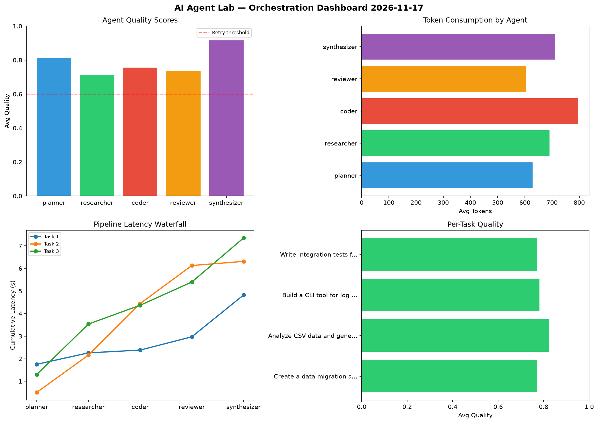

# AI Agent Lab — Orchestration Report 2026-11-17

**Run ID:** `26d0ed1239` | **Tasks:** 4 | **Avg Quality:** 0.786

## Aggregate Metrics

| Metric | Value |
|--------|-------|
| avg_latency | 6.465 |
| total_tokens | 13732 |
| avg_quality | 0.786 |

## Delta vs Yesterday

| Metric | Today | Yesterday | Change |
|--------|-------|-----------|--------|
| avg_latency | 6.465 | 7.173 | 📉 -9.9% |
| total_tokens | 13732 | 13678 | 📈 0.4% |
| avg_quality | 0.786 | 0.776 | 📈 1.3% |

## Pipeline Results

### Create a data migration script for schema v2
| Agent | Quality | Latency | Tokens | Status |
|-------|---------|---------|--------|--------|
| planner | 0.884 | 1.754s | 308 | success |
| researcher | 0.541 | 0.506s | 788 | needs_retry |
| coder | 0.67 | 0.124s | 553 | success |
| reviewer | 0.774 | 0.587s | 719 | success |
| synthesizer | 0.98 | 1.852s | 399 | success |

### Analyze CSV data and generate statistical summary
| Agent | Quality | Latency | Tokens | Status |
|-------|---------|---------|--------|--------|
| planner | 0.605 | 0.508s | 1103 | success |
| researcher | 0.943 | 1.653s | 961 | success |
| coder | 0.849 | 2.282s | 859 | success |
| reviewer | 0.889 | 1.685s | 643 | success |
| synthesizer | 0.831 | 0.184s | 1027 | success |

### Build a CLI tool for log analysis
| Agent | Quality | Latency | Tokens | Status |
|-------|---------|---------|--------|--------|
| planner | 0.808 | 1.303s | 548 | success |
| researcher | 0.701 | 2.234s | 555 | success |
| coder | 0.844 | 0.831s | 1001 | success |
| reviewer | 0.563 | 1.031s | 477 | needs_retry |
| synthesizer | 0.993 | 1.948s | 920 | success |

### Write integration tests for payment processing module
| Agent | Quality | Latency | Tokens | Status |
|-------|---------|---------|--------|--------|
| planner | 0.949 | 0.515s | 555 | success |
| researcher | 0.665 | 2.404s | 461 | success |
| coder | 0.661 | 2.228s | 773 | success |
| reviewer | 0.719 | 1.63s | 579 | success |
| synthesizer | 0.859 | 0.6s | 503 | success |
