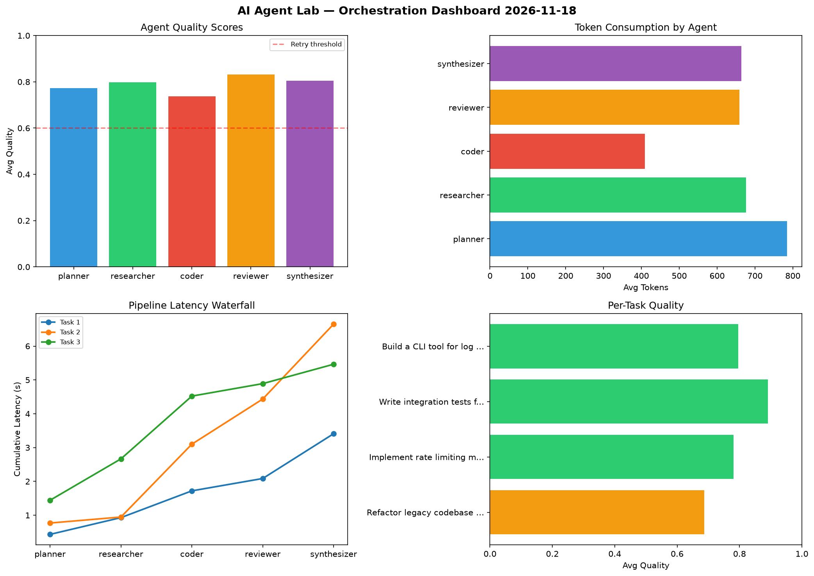

# AI Agent Lab — Orchestration Report 2026-11-18

**Run ID:** `f690c2c3fe` | **Tasks:** 4 | **Avg Quality:** 0.789

## Aggregate Metrics

| Metric | Value |
|--------|-------|
| avg_latency | 6.329 |
| total_tokens | 12769 |
| avg_quality | 0.789 |

## Delta vs Yesterday

| Metric | Today | Yesterday | Change |
|--------|-------|-----------|--------|
| avg_latency | 6.329 | 6.106 | 📈 3.7% |
| total_tokens | 12769 | 13400 | 📉 -4.7% |
| avg_quality | 0.789 | 0.814 | 📉 -3.1% |

## Pipeline Results

### Refactor legacy codebase to use dependency injection
| Agent | Quality | Latency | Tokens | Status |
|-------|---------|---------|--------|--------|
| planner | 0.889 | 0.434s | 618 | success |
| researcher | 0.833 | 0.496s | 568 | success |
| coder | 0.571 | 0.791s | 774 | needs_retry |
| reviewer | 0.552 | 0.365s | 930 | needs_retry |
| synthesizer | 0.592 | 1.324s | 556 | needs_retry |

### Implement rate limiting middleware
| Agent | Quality | Latency | Tokens | Status |
|-------|---------|---------|--------|--------|
| planner | 0.67 | 0.77s | 980 | success |
| researcher | 0.643 | 0.177s | 942 | success |
| coder | 0.922 | 2.154s | 345 | success |
| reviewer | 0.816 | 1.334s | 731 | success |
| synthesizer | 0.854 | 2.216s | 989 | success |

### Write integration tests for payment processing module
| Agent | Quality | Latency | Tokens | Status |
|-------|---------|---------|--------|--------|
| planner | 0.868 | 1.443s | 794 | success |
| researcher | 0.884 | 1.224s | 659 | success |
| coder | 0.848 | 1.855s | 255 | success |
| reviewer | 0.975 | 0.369s | 363 | success |
| synthesizer | 0.882 | 0.573s | 557 | success |

### Build a CLI tool for log analysis
| Agent | Quality | Latency | Tokens | Status |
|-------|---------|---------|--------|--------|
| planner | 0.664 | 2.481s | 747 | success |
| researcher | 0.831 | 2.219s | 535 | success |
| coder | 0.609 | 0.543s | 261 | success |
| reviewer | 0.981 | 2.408s | 612 | success |
| synthesizer | 0.894 | 2.141s | 553 | success |
