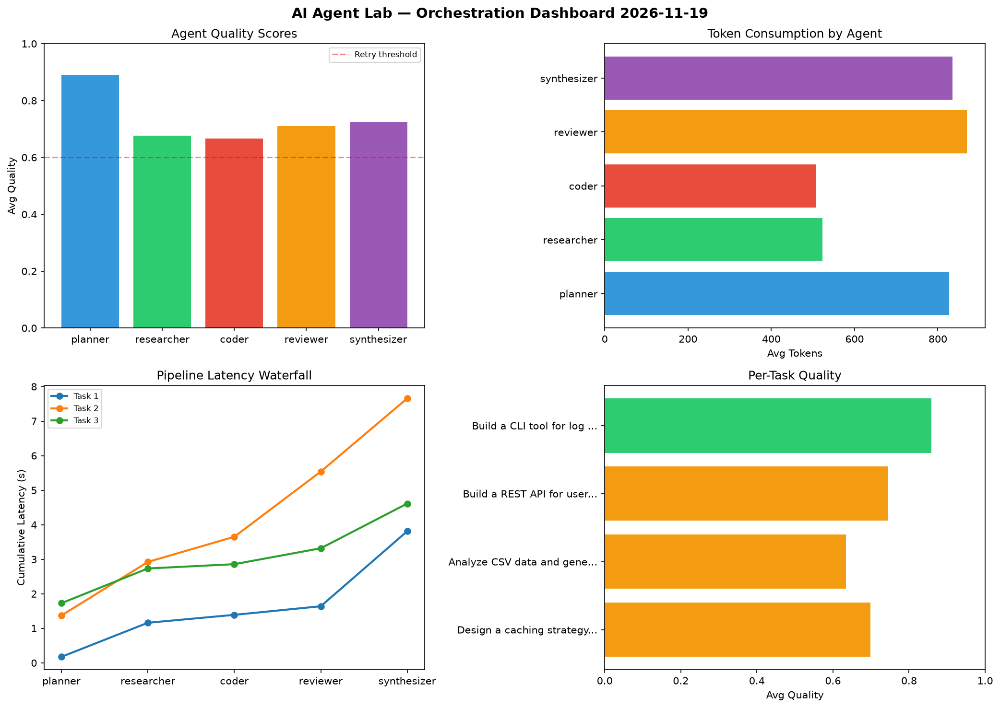

# AI Agent Lab — Orchestration Report 2026-11-19

**Run ID:** `0791ae2cac` | **Tasks:** 4 | **Avg Quality:** 0.734

## Aggregate Metrics

| Metric | Value |
|--------|-------|
| avg_latency | 4.894 |
| total_tokens | 14249 |
| avg_quality | 0.734 |

## Delta vs Yesterday

| Metric | Today | Yesterday | Change |
|--------|-------|-----------|--------|
| avg_latency | 4.894 | 5.998 | 📉 -18.4% |
| total_tokens | 14249 | 13826 | 📈 3.1% |
| avg_quality | 0.734 | 0.754 | 📉 -2.7% |

## Pipeline Results

### Design a caching strategy for high-traffic endpoints
| Agent | Quality | Latency | Tokens | Status |
|-------|---------|---------|--------|--------|
| planner | 0.998 | 0.175s | 442 | success |
| researcher | 0.501 | 0.987s | 960 | needs_retry |
| coder | 0.653 | 0.229s | 830 | success |
| reviewer | 0.789 | 0.249s | 795 | success |
| synthesizer | 0.547 | 2.173s | 834 | needs_retry |

### Analyze CSV data and generate statistical summary
| Agent | Quality | Latency | Tokens | Status |
|-------|---------|---------|--------|--------|
| planner | 0.587 | 1.372s | 1042 | needs_retry |
| researcher | 0.618 | 1.551s | 345 | success |
| coder | 0.551 | 0.729s | 510 | needs_retry |
| reviewer | 0.55 | 1.887s | 830 | needs_retry |
| synthesizer | 0.864 | 2.12s | 896 | success |

### Build a REST API for user authentication
| Agent | Quality | Latency | Tokens | Status |
|-------|---------|---------|--------|--------|
| planner | 0.991 | 1.728s | 765 | success |
| researcher | 0.779 | 1.006s | 243 | success |
| coder | 0.552 | 0.124s | 250 | needs_retry |
| reviewer | 0.79 | 0.461s | 954 | success |
| synthesizer | 0.612 | 1.294s | 816 | success |

### Build a CLI tool for log analysis
| Agent | Quality | Latency | Tokens | Status |
|-------|---------|---------|--------|--------|
| planner | 0.987 | 0.452s | 1058 | success |
| researcher | 0.808 | 0.115s | 545 | success |
| coder | 0.91 | 1.491s | 439 | success |
| reviewer | 0.713 | 0.959s | 901 | success |
| synthesizer | 0.876 | 0.472s | 794 | success |
