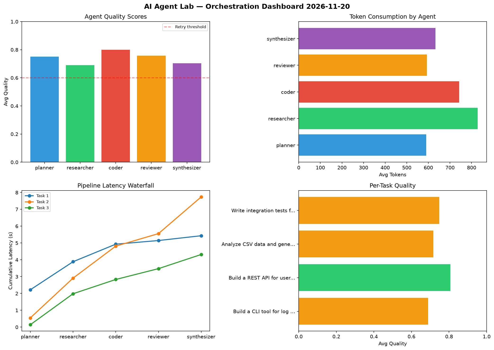

# AI Agent Lab — Orchestration Report 2026-11-20

**Run ID:** `227cba7e2f` | **Tasks:** 4 | **Avg Quality:** 0.74

## Aggregate Metrics

| Metric | Value |
|--------|-------|
| avg_latency | 5.306 |
| total_tokens | 13544 |
| avg_quality | 0.74 |

## Delta vs Yesterday

| Metric | Today | Yesterday | Change |
|--------|-------|-----------|--------|
| avg_latency | 5.306 | 7.257 | 📉 -26.9% |
| total_tokens | 13544 | 14037 | 📉 -3.5% |
| avg_quality | 0.74 | 0.802 | 📉 -7.7% |

## Pipeline Results

### Build a CLI tool for log analysis
| Agent | Quality | Latency | Tokens | Status |
|-------|---------|---------|--------|--------|
| planner | 0.635 | 2.219s | 1171 | success |
| researcher | 0.768 | 1.667s | 479 | success |
| coder | 0.743 | 1.043s | 376 | success |
| reviewer | 0.556 | 0.217s | 457 | needs_retry |
| synthesizer | 0.744 | 0.285s | 212 | success |

### Build a REST API for user authentication
| Agent | Quality | Latency | Tokens | Status |
|-------|---------|---------|--------|--------|
| planner | 0.969 | 0.548s | 339 | success |
| researcher | 0.75 | 2.361s | 1155 | success |
| coder | 0.595 | 1.903s | 691 | needs_retry |
| reviewer | 0.854 | 0.744s | 857 | success |
| synthesizer | 0.867 | 2.181s | 921 | success |

### Analyze CSV data and generate statistical summary
| Agent | Quality | Latency | Tokens | Status |
|-------|---------|---------|--------|--------|
| planner | 0.781 | 0.143s | 323 | success |
| researcher | 0.558 | 1.84s | 875 | needs_retry |
| coder | 0.915 | 0.848s | 965 | success |
| reviewer | 0.72 | 0.644s | 560 | success |
| synthesizer | 0.607 | 0.841s | 507 | success |

### Write integration tests for payment processing module
| Agent | Quality | Latency | Tokens | Status |
|-------|---------|---------|--------|--------|
| planner | 0.619 | 0.674s | 527 | success |
| researcher | 0.681 | 0.208s | 804 | success |
| coder | 0.943 | 1.874s | 938 | success |
| reviewer | 0.899 | 0.35s | 497 | success |
| synthesizer | 0.596 | 0.633s | 890 | needs_retry |
