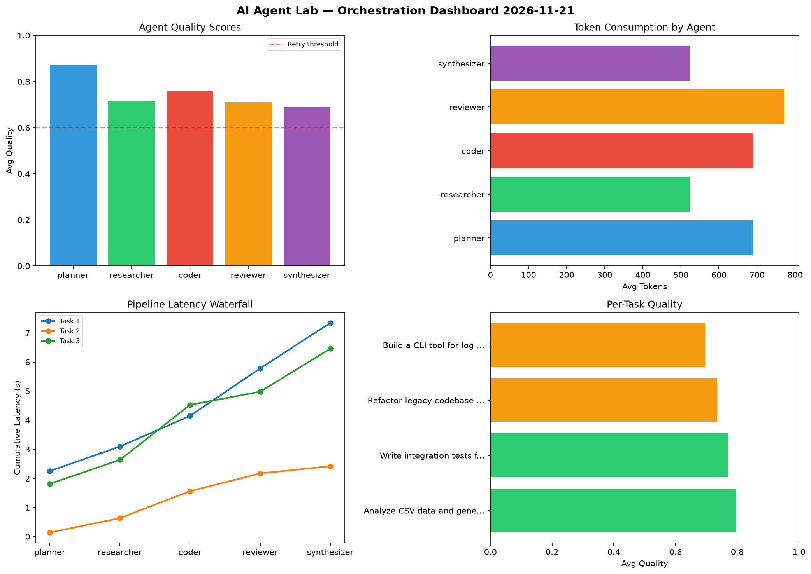

# AI Agent Lab — Orchestration Report 2026-11-21

**Run ID:** `13e0b1dad1` | **Tasks:** 4 | **Avg Quality:** 0.75

## Aggregate Metrics

| Metric | Value |
|--------|-------|
| avg_latency | 5.388 |
| total_tokens | 12797 |
| avg_quality | 0.75 |

## Delta vs Yesterday

| Metric | Today | Yesterday | Change |
|--------|-------|-----------|--------|
| avg_latency | 5.388 | 5.306 | 📈 1.5% |
| total_tokens | 12797 | 13544 | 📉 -5.5% |
| avg_quality | 0.75 | 0.74 | 📈 1.4% |

## Pipeline Results

### Analyze CSV data and generate statistical summary
| Agent | Quality | Latency | Tokens | Status |
|-------|---------|---------|--------|--------|
| planner | 0.851 | 2.251s | 714 | success |
| researcher | 0.871 | 0.844s | 399 | success |
| coder | 0.616 | 1.053s | 718 | success |
| reviewer | 0.886 | 1.635s | 341 | success |
| synthesizer | 0.761 | 1.56s | 411 | success |

### Write integration tests for payment processing module
| Agent | Quality | Latency | Tokens | Status |
|-------|---------|---------|--------|--------|
| planner | 0.886 | 0.139s | 800 | success |
| researcher | 0.82 | 0.496s | 606 | success |
| coder | 0.867 | 0.927s | 848 | success |
| reviewer | 0.614 | 0.61s | 1075 | success |
| synthesizer | 0.675 | 0.247s | 300 | success |

### Refactor legacy codebase to use dependency injection
| Agent | Quality | Latency | Tokens | Status |
|-------|---------|---------|--------|--------|
| planner | 0.864 | 1.814s | 498 | success |
| researcher | 0.626 | 0.822s | 764 | success |
| coder | 0.946 | 1.891s | 206 | success |
| reviewer | 0.615 | 0.454s | 606 | success |
| synthesizer | 0.626 | 1.475s | 702 | success |

### Build a CLI tool for log analysis
| Agent | Quality | Latency | Tokens | Status |
|-------|---------|---------|--------|--------|
| planner | 0.894 | 0.585s | 748 | success |
| researcher | 0.553 | 1.509s | 325 | needs_retry |
| coder | 0.614 | 0.382s | 990 | success |
| reviewer | 0.726 | 1.775s | 1064 | success |
| synthesizer | 0.693 | 1.083s | 682 | success |
