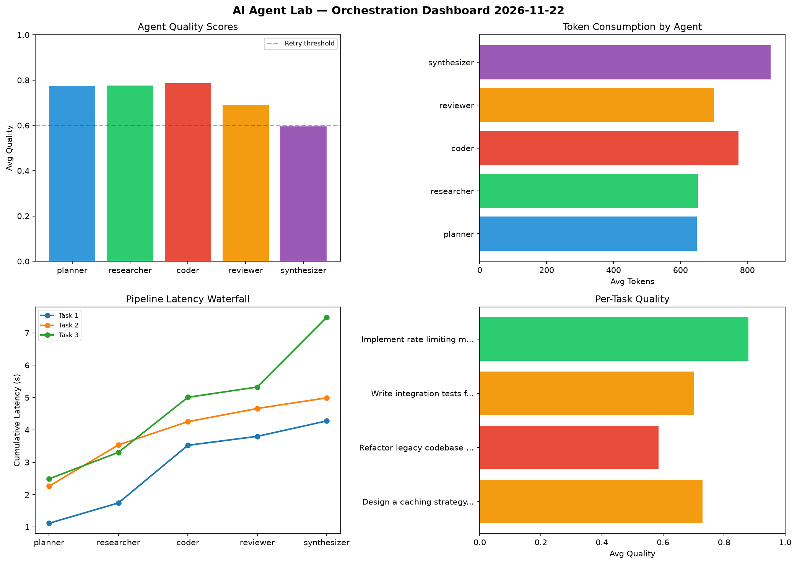

# AI Agent Lab — Orchestration Report 2026-11-22

**Run ID:** `101679f652` | **Tasks:** 4 | **Avg Quality:** 0.724

## Aggregate Metrics

| Metric | Value |
|--------|-------|
| avg_latency | 5.71 |
| total_tokens | 14576 |
| avg_quality | 0.724 |

## Delta vs Yesterday

| Metric | Today | Yesterday | Change |
|--------|-------|-----------|--------|
| avg_latency | 5.71 | 7.204 | 📉 -20.7% |
| total_tokens | 14576 | 15981 | 📉 -8.8% |
| avg_quality | 0.724 | 0.832 | 📉 -13.0% |

## Pipeline Results

### Design a caching strategy for high-traffic endpoints
| Agent | Quality | Latency | Tokens | Status |
|-------|---------|---------|--------|--------|
| planner | 0.638 | 1.116s | 574 | success |
| researcher | 0.905 | 0.628s | 1038 | success |
| coder | 0.901 | 1.781s | 1032 | success |
| reviewer | 0.63 | 0.276s | 533 | success |
| synthesizer | 0.577 | 0.477s | 644 | needs_retry |

### Refactor legacy codebase to use dependency injection
| Agent | Quality | Latency | Tokens | Status |
|-------|---------|---------|--------|--------|
| planner | 0.639 | 2.26s | 669 | success |
| researcher | 0.511 | 1.277s | 733 | needs_retry |
| coder | 0.651 | 0.717s | 765 | success |
| reviewer | 0.593 | 0.409s | 840 | needs_retry |
| synthesizer | 0.532 | 0.328s | 1093 | needs_retry |

### Write integration tests for payment processing module
| Agent | Quality | Latency | Tokens | Status |
|-------|---------|---------|--------|--------|
| planner | 0.877 | 2.488s | 826 | success |
| researcher | 0.81 | 0.819s | 510 | success |
| coder | 0.62 | 1.701s | 558 | success |
| reviewer | 0.677 | 0.318s | 870 | success |
| synthesizer | 0.528 | 2.153s | 695 | needs_retry |

### Implement rate limiting middleware
| Agent | Quality | Latency | Tokens | Status |
|-------|---------|---------|--------|--------|
| planner | 0.934 | 0.768s | 526 | success |
| researcher | 0.878 | 1.384s | 329 | success |
| coder | 0.975 | 0.435s | 737 | success |
| reviewer | 0.863 | 2.462s | 558 | success |
| synthesizer | 0.749 | 1.042s | 1046 | success |
