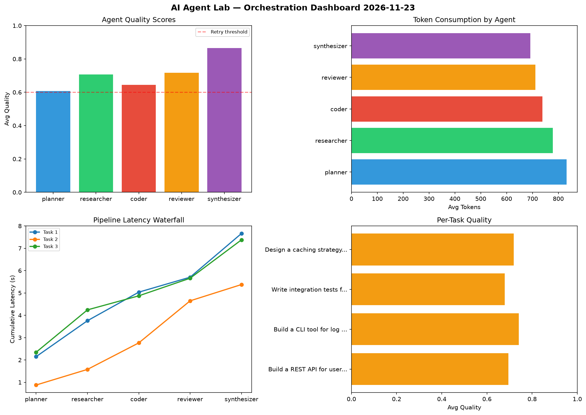

# AI Agent Lab — Orchestration Report 2026-11-23

**Run ID:** `d852d8757d` | **Tasks:** 4 | **Avg Quality:** 0.709

## Aggregate Metrics

| Metric | Value |
|--------|-------|
| avg_latency | 7.133 |
| total_tokens | 15014 |
| avg_quality | 0.709 |

## Delta vs Yesterday

| Metric | Today | Yesterday | Change |
|--------|-------|-----------|--------|
| avg_latency | 7.133 | 6.793 | 📈 5.0% |
| total_tokens | 15014 | 14796 | 📈 1.5% |
| avg_quality | 0.709 | 0.828 | 📉 -14.4% |

## Pipeline Results

### Build a REST API for user authentication
| Agent | Quality | Latency | Tokens | Status |
|-------|---------|---------|--------|--------|
| planner | 0.529 | 2.148s | 658 | needs_retry |
| researcher | 0.68 | 1.609s | 921 | success |
| coder | 0.568 | 1.278s | 435 | needs_retry |
| reviewer | 0.718 | 0.67s | 929 | success |
| synthesizer | 0.978 | 1.956s | 1245 | success |

### Build a CLI tool for log analysis
| Agent | Quality | Latency | Tokens | Status |
|-------|---------|---------|--------|--------|
| planner | 0.544 | 0.878s | 880 | needs_retry |
| researcher | 0.827 | 0.699s | 734 | success |
| coder | 0.728 | 1.187s | 1063 | success |
| reviewer | 0.71 | 1.883s | 915 | success |
| synthesizer | 0.894 | 0.729s | 319 | success |

### Write integration tests for payment processing module
| Agent | Quality | Latency | Tokens | Status |
|-------|---------|---------|--------|--------|
| planner | 0.585 | 2.345s | 664 | needs_retry |
| researcher | 0.808 | 1.897s | 923 | success |
| coder | 0.711 | 0.629s | 706 | success |
| reviewer | 0.572 | 0.788s | 592 | needs_retry |
| synthesizer | 0.717 | 1.718s | 482 | success |

### Design a caching strategy for high-traffic endpoints
| Agent | Quality | Latency | Tokens | Status |
|-------|---------|---------|--------|--------|
| planner | 0.775 | 1.685s | 1125 | success |
| researcher | 0.512 | 1.737s | 539 | needs_retry |
| coder | 0.568 | 1.942s | 751 | needs_retry |
| reviewer | 0.866 | 1.261s | 410 | success |
| synthesizer | 0.875 | 1.492s | 723 | success |
