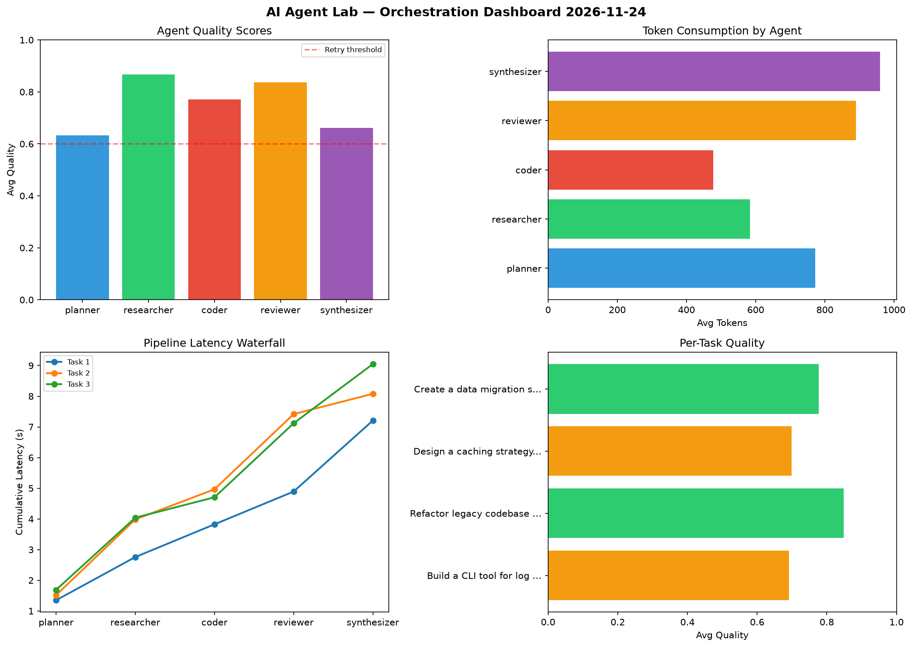

# AI Agent Lab — Orchestration Report 2026-11-24

**Run ID:** `f1adf9111e` | **Tasks:** 4 | **Avg Quality:** 0.754

## Aggregate Metrics

| Metric | Value |
|--------|-------|
| avg_latency | 8.091 |
| total_tokens | 14726 |
| avg_quality | 0.754 |

## Delta vs Yesterday

| Metric | Today | Yesterday | Change |
|--------|-------|-----------|--------|
| avg_latency | 8.091 | 7.133 | 📈 13.4% |
| total_tokens | 14726 | 15014 | 📉 -1.9% |
| avg_quality | 0.754 | 0.709 | 📈 6.3% |

## Pipeline Results

### Build a CLI tool for log analysis
| Agent | Quality | Latency | Tokens | Status |
|-------|---------|---------|--------|--------|
| planner | 0.514 | 1.349s | 905 | needs_retry |
| researcher | 0.865 | 1.408s | 533 | success |
| coder | 0.86 | 1.067s | 447 | success |
| reviewer | 0.71 | 1.069s | 1101 | success |
| synthesizer | 0.504 | 2.315s | 1075 | needs_retry |

### Refactor legacy codebase to use dependency injection
| Agent | Quality | Latency | Tokens | Status |
|-------|---------|---------|--------|--------|
| planner | 0.637 | 1.515s | 652 | success |
| researcher | 0.989 | 2.469s | 323 | success |
| coder | 0.842 | 0.982s | 672 | success |
| reviewer | 0.954 | 2.451s | 771 | success |
| synthesizer | 0.825 | 0.662s | 981 | success |

### Design a caching strategy for high-traffic endpoints
| Agent | Quality | Latency | Tokens | Status |
|-------|---------|---------|--------|--------|
| planner | 0.598 | 1.688s | 744 | needs_retry |
| researcher | 0.706 | 2.352s | 819 | success |
| coder | 0.576 | 0.665s | 458 | needs_retry |
| reviewer | 0.868 | 2.414s | 780 | success |
| synthesizer | 0.745 | 1.93s | 1039 | success |

### Create a data migration script for schema v2
| Agent | Quality | Latency | Tokens | Status |
|-------|---------|---------|--------|--------|
| planner | 0.785 | 2.44s | 789 | success |
| researcher | 0.909 | 1.171s | 657 | success |
| coder | 0.805 | 1.189s | 331 | success |
| reviewer | 0.814 | 1.333s | 908 | success |
| synthesizer | 0.571 | 1.897s | 741 | needs_retry |
