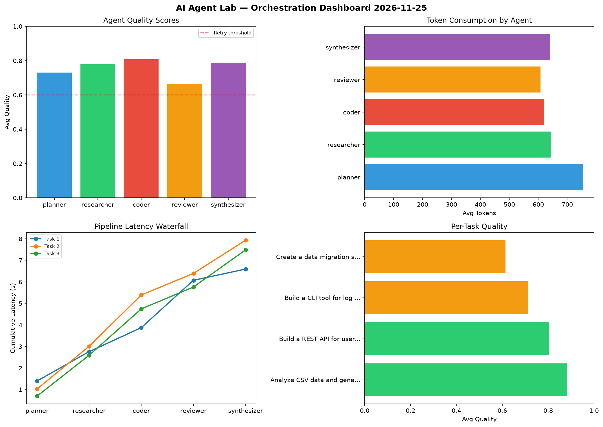

# AI Agent Lab — Orchestration Report 2026-11-25

**Run ID:** `633ecfc63c` | **Tasks:** 4 | **Avg Quality:** 0.754

## Aggregate Metrics

| Metric | Value |
|--------|-------|
| avg_latency | 6.68 |
| total_tokens | 13065 |
| avg_quality | 0.754 |

## Delta vs Yesterday

| Metric | Today | Yesterday | Change |
|--------|-------|-----------|--------|
| avg_latency | 6.68 | 7.372 | 📉 -9.4% |
| total_tokens | 13065 | 14510 | 📉 -10.0% |
| avg_quality | 0.754 | 0.818 | 📉 -7.8% |

## Pipeline Results

### Analyze CSV data and generate statistical summary
| Agent | Quality | Latency | Tokens | Status |
|-------|---------|---------|--------|--------|
| planner | 0.931 | 1.398s | 914 | success |
| researcher | 0.885 | 1.363s | 926 | success |
| coder | 0.949 | 1.114s | 500 | success |
| reviewer | 0.864 | 2.197s | 552 | success |
| synthesizer | 0.788 | 0.52s | 256 | success |

### Build a REST API for user authentication
| Agent | Quality | Latency | Tokens | Status |
|-------|---------|---------|--------|--------|
| planner | 0.845 | 1.028s | 593 | success |
| researcher | 0.662 | 1.982s | 422 | success |
| coder | 0.979 | 2.381s | 375 | success |
| reviewer | 0.617 | 1.0s | 525 | success |
| synthesizer | 0.921 | 1.539s | 1014 | success |

### Build a CLI tool for log analysis
| Agent | Quality | Latency | Tokens | Status |
|-------|---------|---------|--------|--------|
| planner | 0.525 | 0.695s | 621 | needs_retry |
| researcher | 0.893 | 1.899s | 202 | success |
| coder | 0.71 | 2.149s | 810 | success |
| reviewer | 0.606 | 1.016s | 541 | success |
| synthesizer | 0.836 | 1.724s | 530 | success |

### Create a data migration script for schema v2
| Agent | Quality | Latency | Tokens | Status |
|-------|---------|---------|--------|--------|
| planner | 0.622 | 1.193s | 891 | success |
| researcher | 0.679 | 0.13s | 1021 | success |
| coder | 0.594 | 0.142s | 797 | needs_retry |
| reviewer | 0.572 | 1.03s | 812 | needs_retry |
| synthesizer | 0.603 | 2.221s | 763 | success |
