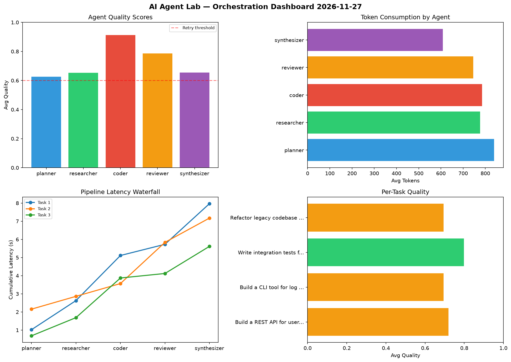

# AI Agent Lab — Orchestration Report 2026-11-27

**Run ID:** `f9983878dc` | **Tasks:** 4 | **Avg Quality:** 0.726

## Aggregate Metrics

| Metric | Value |
|--------|-------|
| avg_latency | 7.208 |
| total_tokens | 15025 |
| avg_quality | 0.726 |

## Delta vs Yesterday

| Metric | Today | Yesterday | Change |
|--------|-------|-----------|--------|
| avg_latency | 7.208 | 5.088 | 📈 41.7% |
| total_tokens | 15025 | 15387 | 📉 -2.4% |
| avg_quality | 0.726 | 0.758 | 📉 -4.2% |

## Pipeline Results

### Build a REST API for user authentication
| Agent | Quality | Latency | Tokens | Status |
|-------|---------|---------|--------|--------|
| planner | 0.613 | 1.02s | 905 | success |
| researcher | 0.651 | 1.605s | 924 | success |
| coder | 0.901 | 2.486s | 916 | success |
| reviewer | 0.848 | 0.617s | 739 | success |
| synthesizer | 0.584 | 2.239s | 960 | needs_retry |

### Build a CLI tool for log analysis
| Agent | Quality | Latency | Tokens | Status |
|-------|---------|---------|--------|--------|
| planner | 0.722 | 2.154s | 539 | success |
| researcher | 0.616 | 0.706s | 420 | success |
| coder | 0.969 | 0.705s | 791 | success |
| reviewer | 0.589 | 2.27s | 839 | needs_retry |
| synthesizer | 0.575 | 1.338s | 494 | needs_retry |

### Write integration tests for payment processing module
| Agent | Quality | Latency | Tokens | Status |
|-------|---------|---------|--------|--------|
| planner | 0.514 | 0.683s | 1080 | needs_retry |
| researcher | 0.675 | 1.003s | 1031 | success |
| coder | 0.997 | 2.185s | 889 | success |
| reviewer | 0.908 | 0.249s | 585 | success |
| synthesizer | 0.898 | 1.494s | 286 | success |

### Refactor legacy codebase to use dependency injection
| Agent | Quality | Latency | Tokens | Status |
|-------|---------|---------|--------|--------|
| planner | 0.653 | 1.527s | 833 | success |
| researcher | 0.672 | 2.214s | 732 | success |
| coder | 0.784 | 0.13s | 546 | success |
| reviewer | 0.8 | 1.848s | 820 | success |
| synthesizer | 0.564 | 2.358s | 696 | needs_retry |
