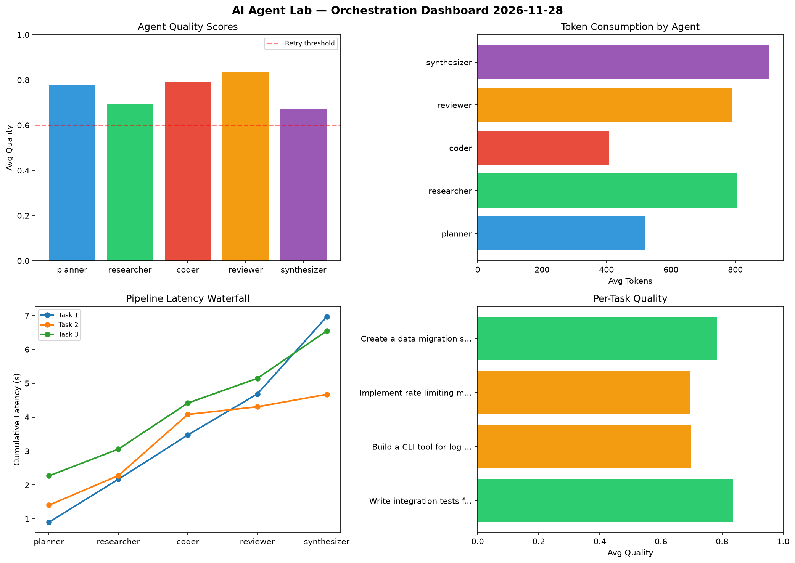

# AI Agent Lab — Orchestration Report 2026-11-28

**Run ID:** `f78348751a` | **Tasks:** 4 | **Avg Quality:** 0.753

## Aggregate Metrics

| Metric | Value |
|--------|-------|
| avg_latency | 6.832 |
| total_tokens | 13706 |
| avg_quality | 0.753 |

## Delta vs Yesterday

| Metric | Today | Yesterday | Change |
|--------|-------|-----------|--------|
| avg_latency | 6.832 | 6.054 | 📈 12.9% |
| total_tokens | 13706 | 14099 | 📉 -2.8% |
| avg_quality | 0.753 | 0.771 | 📉 -2.3% |

## Pipeline Results

### Write integration tests for payment processing module
| Agent | Quality | Latency | Tokens | Status |
|-------|---------|---------|--------|--------|
| planner | 0.881 | 0.899s | 842 | success |
| researcher | 0.89 | 1.271s | 628 | success |
| coder | 0.875 | 1.307s | 675 | success |
| reviewer | 0.978 | 1.209s | 399 | success |
| synthesizer | 0.551 | 2.277s | 878 | needs_retry |

### Build a CLI tool for log analysis
| Agent | Quality | Latency | Tokens | Status |
|-------|---------|---------|--------|--------|
| planner | 0.677 | 1.405s | 774 | success |
| researcher | 0.687 | 0.874s | 879 | success |
| coder | 0.732 | 1.804s | 277 | success |
| reviewer | 0.792 | 0.224s | 963 | success |
| synthesizer | 0.608 | 0.367s | 818 | success |

### Implement rate limiting middleware
| Agent | Quality | Latency | Tokens | Status |
|-------|---------|---------|--------|--------|
| planner | 0.595 | 2.27s | 207 | needs_retry |
| researcher | 0.67 | 0.789s | 1061 | success |
| coder | 0.686 | 1.359s | 317 | success |
| reviewer | 0.679 | 0.727s | 719 | success |
| synthesizer | 0.846 | 1.401s | 920 | success |

### Create a data migration script for schema v2
| Agent | Quality | Latency | Tokens | Status |
|-------|---------|---------|--------|--------|
| planner | 0.962 | 0.355s | 261 | success |
| researcher | 0.52 | 1.984s | 655 | needs_retry |
| coder | 0.868 | 2.464s | 361 | success |
| reviewer | 0.896 | 2.4s | 1075 | success |
| synthesizer | 0.675 | 1.94s | 997 | success |
